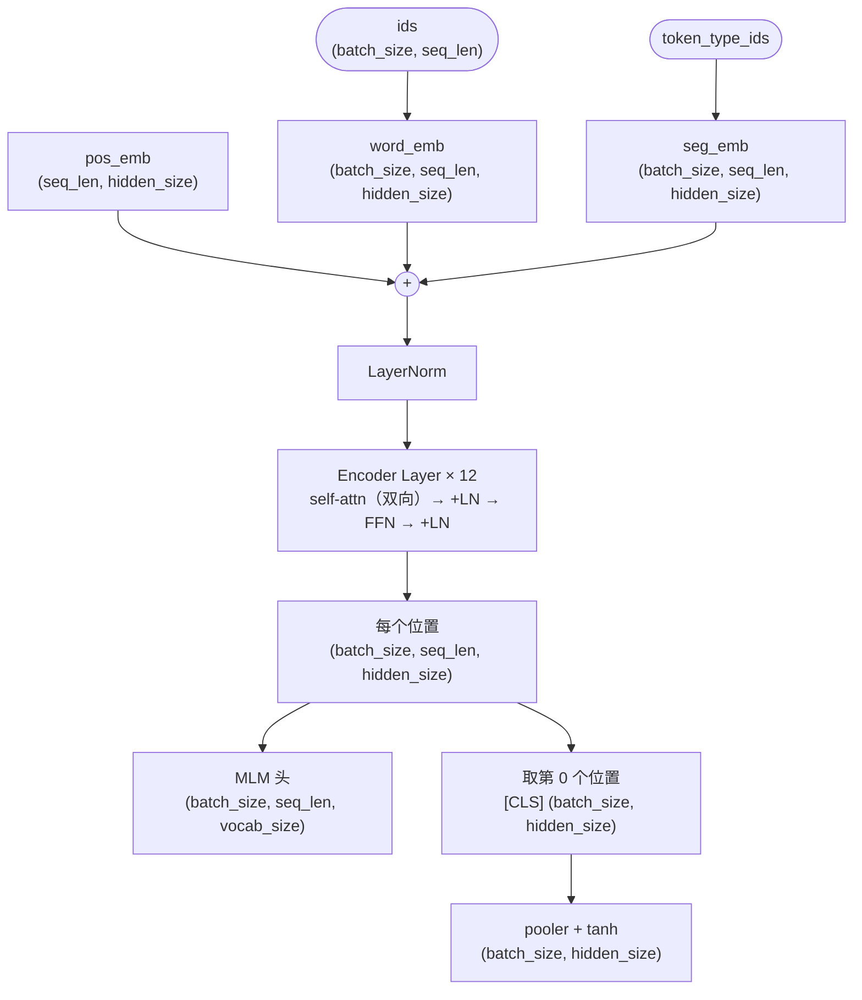

# BERT 架构

## 1. 任务

BERT 做的是**完形填空**（Masked Language Modeling）：盖住句子里的一些词，让模型猜。

```
输入   The capital of France is [MASK] .
输出   每个位置一个 30522 维的分布，[MASK] 那一位最高的是 "paris"
```

和 Transformer 的翻译任务比，最大的区别是：**输入一句话，输出还是这句话的每个位置**，
没有"生成另一条序列"这回事。所以它只需要 encoder。

论文在 GLUE 等 11 个理解任务上验证，另外还有两个预训练目标（MLM + NSP）。

## 2. 记号

模型结构全在 [`config.json`](config.json) 里（本目录是 Hugging Face 官方 `bert-base-uncased` 的副本），直接用它的字段名，不再另起一套符号。
只有 `batch_size` 和 `seq_len` 是运行时才有的。

| `config.json` 字段 | 值 | 是什么 |
| --- | --- | --- |
| `hidden_size` | 768 | 主干宽度 |
| `num_attention_heads` | 12 | 头数 |
| `num_hidden_layers` | 12 | encoder 层数 |
| `intermediate_size` | 3072 | FFN 中间宽度 |
| `vocab_size` | 30522 | 词表大小 |
| `max_position_embeddings` | 512 | 最长位置数 |
| `type_vocab_size` | 2 | `seg_emb` 的大小（句子 A/B） |
| `hidden_act` | `gelu` | FFN 和 MLM 头的激活函数 |
| `layer_norm_eps` | **1e-12** | LayerNorm 的 eps。PyTorch 默认 `1e-5`，用错 logits 差 0.01 量级 |
| `hidden_dropout_prob` | 0.1 | 残差后的 dropout（推理时关掉） |
| `attention_probs_dropout_prob` | 0.1 | attention 权重上的 dropout |
| `position_embedding_type` | `absolute` | 绝对位置，可学习 |
| `pad_token_id` | 0 | padding 的 id |

两个运行时符号和一个算出来的：

| 符号 | 值 | 来源 |
| --- | --- | --- |
| `batch_size` | 1 | 运行时 |
| `seq_len` | 9 | 运行时（含 `[CLS]` / `[SEP]`） |
| `head_dim` | 64 | `hidden_size / num_attention_heads`，config 里没有这个字段 |

## 3. 结构

### 3.1 和 Transformer encoder 比，差在哪

| 项 | Transformer encoder | BERT |
| --- | --- | --- |
| 注意力方向 | 双向 | **一样，双向** |
| causal mask | 没有 | **没有** |
| decoder | 有 | 删掉 |
| cross-attention | 有 | 删掉 |
| 位置编码 | sin/cos，固定 | **`nn.Embedding`，可学习** |
| 额外输入 | 无 | **`token_type_ids`（句子 A/B）** |
| 输出头 | 无 | **MLM + NSP** |
| 层数 | 6 | 12 |

**没有 causal mask 是重点**：BERT 不需要"预测下一个词"，它要的是每个位置都能看到左右两边，
才能从上下文同时推断被盖住的词。

### 3.2 图



### 3.3 shape 流水（真实跑出来的）

`"The capital of France is [MASK]."` → 9 个 token：

| 步骤 | 形状 |
| --- | --- |
| ids | `(1, 9)` |
| word_emb | `(1, 9, 768)` |
| pos_emb | `(1, 9, 768)`（广播） |
| seg_emb | `(1, 9, 768)` |
| 三者相加 + LN | `(1, 9, 768)` |
| q/k/v 拆头 | `(1, 12, 9, 64)` |
| scores | `(1, 12, 9, 9)` |
| softmax | `(1, 12, 9, 9)` |
| P @ V + 拼头 | `(1, 9, 768)` |
| intermediate | `(1, 9, 3072)` |
| output.dense | `(1, 9, 768)` |
| [CLS] | `(1, 768)` |
| MLM logits | `(1, 9, 30522)` |

**全程没有一处 `seq_len` 和另一个长度相遇**——这是和 Transformer 最大的形状差别。
没有 decoder、没有 cross-attention，就没有 `tgt_len × src_len`。

### 3.4 三种 embedding 为什么要相加

```
word_emb      这个词是谁
pos_emb       它在第几位（可学习）
seg_emb       它属于第几句（A 还是 B）
```

三者都是 `(batch_size, seq_len, hidden_size)`，逐元素相加，宽度不变。
`seg_emb` 只对"输入两句话"的任务（如 NSP、问答）有意义，单句时全是 0。

### 3.5 MLM 头（Masked Language Modeling，掩码语言建模）

```
每个位置 (1, 9, 768)
  → Linear(768, 768) + GELU + LayerNorm   (1, 9, 768)
  → Linear(768, 30522)                    (1, 9, 30522)
```

最后一层的权重和 `word_emb` **共享**（weight tying），只额外加一个 30522 的 bias。

## 4. 参数

### 一层

先把两个乘法约出来：

```
768 × 768 = (3 × 256) × (3 × 256)
          = 9 × 256 × 256
          = 9 × 64 × (4 × 256)      ← 4 × 256 = 1024 = 1K
          = 576 × 1K
          = 576K

768 × 3072 = (3 × 256) × (3 × 1024)
           = 9 × 256 × 1024
           = 9 × 256 × 1K
           = 2,304 × 1K
           = 2,304K ≈ 2.3M
```

| 部分 | 完整式子 | 参数量 |
| --- | --- | --- |
| `q/k/v/out` 四个投影 | 4 × (768×768 + 768) = 4 × (576K + 768) = 2,304K + 3K | ≈2.3M |
| `intermediate` | 768×3072 + 3072 = 2,304K + 3K | ≈2.3M |
| `output.dense` | 3072×768 + 768 = 2,304K + 768 | ≈2.3M |
| `LayerNorm` ×2 | 2 × (768 + 768) = 2 × 1.5K | 3K |
| **一层合计** | 2.3M × 3 | **≈6.9M** |

三个 `2,304K` 不是巧合：`3072 = 4 × 768`，所以 `768×3072 = 4 × 768² = 4 × 576K`。
**FFN 占 4.6M，注意力占 2.3M**，FFN 是两倍，和 Transformer 一样。

### 整个模型

| 部分 | 约算 | 参数量 |
| --- | --- | --- |
| embedding | word 30522×768 ≈ 22.4M + pos 512×768 = 384K + seg 1.5K + LN 1.5K | 22.7M |
| 12 层 | 6.76M × 12 | 81.1M |
| pooler | 768×768 + 768 = 576K | 0.56M |
| MLM 头 | transform 576K + LN 1.5K + bias 30K | 0.59M |
| **合计** | | **105.0M** |

精确值是 110,104,890。和 HuggingFace 的 `BertForMaskedLM`（109,514,298）差 590,592，
**正好是 pooler**——HF 的 MLM 版本不带 pooler，我们的保留着（分类任务要用）。

## 5. 计算量

### 规则

```
矩阵乘 (m, k) @ (k, n) → m × k × n 次乘加，× 2 = FLOPs
```

BERT 里每个 Linear 的 `m` 都是 `seq_len`，`k × n` 是权重个数。本例 `seq_len = 9`。

### 一个 Linear 的算法，展开看

以 `q_proj`（`768 → 768`）为例：

```
9 × 768 × 768
= 9 × 576K             ← 768² = 576K
= 5,184K
= 5.18M 次乘加

× 2 = 10.4M FLOPs      ← 乘加算两次
```

### encoder 一层

| 操作 | 公式 | 代入 | FLOPs | 占比 |
| --- | --- | --- | --- | --- |
| `q_proj` | `2 × seq_len × 768 × 768` | `2 × 9 × 576K` | 10.4M | 8.3% |
| `k_proj` | 同上 | | 10.4M | 8.3% |
| `v_proj` | 同上 | | 10.4M | 8.3% |
| `scores` | `2 × num_attention_heads × seq_len × seq_len × head_dim` | `2 × 12 × 9×9 × 64` | 124K | 0.1% |
| `P @ V` | 同上 | | 124K | 0.1% |
| `out_proj` | `2 × seq_len × 768 × 768` | `2 × 9 × 576K` | 10.4M | 8.3% |
| `intermediate` | `2 × seq_len × 768 × 3072` | `2 × 9 × 2,304K` | 41.5M | 33.3% |
| `output.dense` | `2 × seq_len × 3072 × 768` | `2 × 9 × 2,304K` | 41.5M | 33.3% |
| **合计** | | | **≈124M** | **100%** |

三条能直接记住的：

- **FFN 占 2/3**（`intermediate` + `output.dense` = 83M），注意力四个投影占 1/3
- **`intermediate` 一个就等于 1/3**——`3072 = 4 × 768`，一次变宽顶四次投影
- **`9×9` 那两项合计 0.2%**，`seq_len = 9` 时可以当 0

### 12 层 + MLM 头

```
encoder 12 层 = 124M × 12          ≈ 1.5G
MLM 头        = 2 × 9 × 768 × 30522 ≈ 0.42G
                                   ─────────
                             合计   ≈ 1.9G
```

MLM 头展开：`9 × 768 × 30522 = 9 × 23.4M = 211M` 次乘加，`× 2 = 422M`。

### 长上下文：注意力的平方项

`seq_len = 9` 时 `scores` 和 `P @ V` 只有 124K，可以忽略。但它是 `O(seq_len²)`：

```
2 × num_attention_heads × seq_len × seq_len × head_dim
= 2 × 12 × 512 × 512 × 64
= 402,653,184 ≈ 403M
```

`seq_len = 512` 时，单层这两项就有 403M，**超过整层 FFN 的 83M**。
这是 BERT 最长 512 的代价：再长，注意力会彻底压过 FFN。

## 6. 访存

### 规则

```
Bytes = (读入元素数 + 权重元素数 + 写出元素数) × 4 字节（fp32）
```

BERT 只有**一次前向**，没有 prefill / decode 之分：输入进去，权重要读一遍。`seq_len = 9`。

### 一个投影怎么算

以 `q_proj` 为例：

```
读入   9 × 768 = 6,912 ≈ 6.75K
权重   768 × 768 = 576K
写出   9 × 768 = 6,912 ≈ 6.75K
       ─────────────────────
合计   576K + 13.5K ≈ 589.5K
× 4 字节 = 2,358K ≈ 2.3M
```

### ① self-attention

| 操作 | 权重 | 读入+写出 | 字节 |
| --- | --- | --- | --- |
| `q/k/v/out` 四个投影 | 4 × 576K | 4 × 13.5K | 9,432K ≈ 9.2M |
| `scores` | 0（无参数） | `(1,12,9,9)` 的读写 | 0.01M |
| **小计** | | | **≈9.2M** |

`scores` / `softmax` / `P @ V` 没有权重，只有 `9×9` 的中间张量，可以忽略。

### ② FFN

| 操作 | 权重 | 读入+写出 | 字节 |
| --- | --- | --- | --- |
| `intermediate` | 2,304K | 27K + 6.75K | 9.1M |
| `output.dense` | 2,304K | 6.75K + 27K | 9.1M |
| **小计** | | | **≈18.2M** |

### 一层合计

```
9.2（self） + 18.2（FFN） + 0.15（LayerNorm×2 + bias） ≈ 27.6M
```

### 12 层 + MLM 头

| 部分 | 字节 | 占比 |
| --- | --- | --- |
| encoder 12 层 | 331M | 78% |
| MLM 头 | 93M | 22% |
| **合计** | **≈424M** | 100% |

MLM 头里的 `to_vocab`：`30522 × 768 = 22.4M` 个权重，`× 4 = 90M`——
**一个矩阵就顶 3 层 encoder**。

### 代进公式

| 项 | 值 |
| --- | --- |
| 访存 | 424M |
| FLOPs | 1.9G |
| 算术强度 | `1.9G / 424M ≈ 4.5 flop/byte` |

算术强度 4.5 比 GPT 的 decode（0.61）高一个数量级——**BERT 没有逐 token 的重复读**，
所以更容易跑满算力。batch 越大，权重摊得越薄，吞吐越高。

## 7. 位置编码：可学习的

BERT 用 `nn.Embedding(512, 768)`，不是 sin/cos：

| | Transformer | BERT |
| --- | --- | --- |
| 怎么来 | 公式算，固定 | 训练学出来 |
| 参数 | 0 | 512 × 768 = 384K |
| 上限 | 由公式决定，理论可外推 | 硬上限 512 个位置 |

代价是丢了外推能力：句子超过 512 个 token 直接截断。
好处是位置表示可以跟着任务调，短句子上通常更好。

## 8. 一句话总结

> BERT = Transformer 的 encoder × 12 + 三种 embedding 相加 + MLM 头。
> 没有 decoder、没有 cross-attention、没有 causal mask，所以整个模型里
> **长度和长度从不相遇**，`scores` 永远是 `(seq_len, seq_len)` 的方阵。
