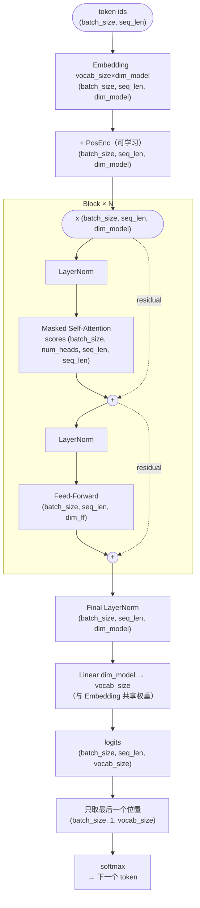

# GPT

## GPT 单栈

同一套零件，删掉 encoder 和 cross-attention 之后的样子：

对比 Transformer 少掉的：

- 整个 encoder
- cross-attention
- 两条序列塌成一条，`q_len ≠ k_len` 的情况彻底消失
- 位置编码从 sin/cos 换成可学习的 `nn.Embedding(max_len, dim_model)`

## 论文这条线

| 年份 | 论文 | 架构上有新东西吗 | 真正的贡献 |
| --- | --- | --- | --- |
| 2018 | GPT-1《Improving Language Understanding by Generative Pre-Training》 | 没有，就是 Transformer decoder | "先预训练、再微调"这个范式 |
| 2019 | GPT-2《Language Models are Unsupervised Multitask Learners》 | 没有，放大 + 换 tokenizer | zero-shot，不微调也能做多任务 |
| 2020 | GPT-3《Language Models are Few-Shot Learners》 | 没有，放大到 175B | in-context learning |
| 2022 | InstructGPT《Training language models to follow instructions with human feedback》 | 没有 | RLHF，ChatGPT 的直接前身 |
| 2023 | GPT-4《GPT-4 Technical Report》 | **不公开** | 只有评测，参数 / 数据 / 架构全部保密 |
| 2024+ | GPT-4o / 4.1 / 5 | **不公开** | 只有 blog 和 system card |

两句话结论：

1. **前三篇在架构上没有增量。** 三篇读下来，shape 表一个字都不用改 ——
   都是 decoder-only，只差层数和宽度。它们讲的是训练范式和能力，不是结构。
2. **不是"后来不发论文了"，是不再公开技术细节。** GPT-4 起仍有 technical report，
   但里面没有参数量、没有数据规模、没有架构图，只剩评测和安全性说明。

所以对当前这条 shape 路线，值得看的是：

- **GPT-2 的 config + 权重** —— 有开源 checkpoint，可以真正对形状
- **InstructGPT** —— 解释 ChatGPT 为什么能用
- GPT-1/2/3 的论文可以扫一眼 introduction，收益在"为什么这么训"，不在"怎么搭"
