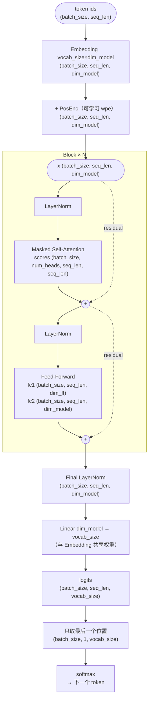

# GPT-2（124M）

## 它解决什么问题

GPT-2 做的是**下一 token 预测**：给一段文本，预测下一个 token；把预测接回输入，重复，就是生成。

它和 Transformer 2017 用的是同一套 block，只保留 decoder：

- 删掉整个 encoder
- 删掉 cross-attention
- 只剩一条序列，`q_len` 和 `kv_len` 不再来自两个长度
- 位置编码从 sin/cos 换成可学习的 `wpe`

训练时整句喂进去，每个位置都预测下一个 token；推理时一个 token 一个 token 往后接。
训练和推理的 shape 在 prefill 阶段相同，差别在 decode 阶段：`q_len = 1`，并且要带 KV cache。

GPT-2 124M 的配置：

| 名字 | 值 |
| --- | --- |
| `vocab_size` | 50257 |
| `dim_model` | 768 |
| `num_layers` | 12 |
| `num_heads` | 12 |
| `dim_k` | 64（768 / 12） |
| `dim_ff` | 3072（4 × 768） |
| `max_pos` | 1024 |
| 参数 | **124,439,808** |

## 记号

和 Transformer 那篇相同的部分不再重复，只列 GPT-2 新出现的：

| 名字 | 是什么 |
| --- | --- |
| `seq_len` | 一条序列的 token 数；prefill 时是 prompt 长度，decode 时是 1 |
| `q_len` | 当前这次 forward 的 query 数：prefill = `seq_len`，decode = 1 |
| `kv_len` | K/V 的长度：prefill = `seq_len`，decode = 历史长度 + 1 |
| `max_pos` | 位置嵌入表的最大长度，GPT-2 是 1024 |
| `c_attn` | 一个 Linear 一次算出 Q/K/V：768 → 2304，再切成三份 |
| `wte` / `wpe` | token embedding / 可学习位置 embedding |
| KV cache | decode 时缓存每层历史 K/V，避免重算 |

## 怎么读图

和 Transformer 那篇的图例一致：

| 记号 | 含义 |
| --- | --- |
| 箭头 | 数据流方向，和代码同向（从上往下） |
| 方框第二行 | 该步的关键张量形状 |
| 虚线 | 残差，从子层输入绕过子层 |
| `(+)` 圆圈 | 逐元素相加 |
| `× N` | 重复 N 次，每层权重独立，形状不变 |

## GPT 单栈

同一套零件，删掉 encoder 和 cross-attention 之后的样子：



和 Transformer 的差异：

| | Transformer 2017 | GPT-2 |
| --- | --- | --- |
| 结构 | Enc×N + Dec×N | Dec×N |
| cross-attention | 有 | 无 |
| 序列 | `src_len` 和 `tgt_len` 两条 | 只有一条 `seq_len` |
| 位置编码 | sin/cos，固定 | `wpe`，可学习 |
| LayerNorm | post-LN | **pre-LN**：`x + 子层(LN(x))` |
| FFN 激活 | ReLU | GELU（tanh 近似） |
| Q/K/V | 三个独立 Linear | 一个 `c_attn`（768→2304），再切 |

## causal mask

GPT-2 的 self-attention 是因果的：位置 `t` 只能看 `≤ t`。

prefill 时 `q_len = kv_len = seq_len`，mask 是下三角（行是 q、列是 k：左下含对角线可见，右上被屏蔽）。以 `seq_len = 4` 为例：

|  | k0 | k1 | k2 | k3 | softmax 后 |
| --- | --- | --- | --- | --- | --- |
| **q0** | ok | -inf | -inf | -inf | `[1, 0, 0, 0]` |
| **q1** | ok | ok | -inf | -inf | `[.5, .5, 0, 0]` |
| **q2** | ok | ok | ok | -inf | `[.33, .33, .33, 0]` |
| **q3** | ok | ok | ok | ok | `[.25, .25, .25, .25]` |

decode 时 `q_len = 1`，新的 query 可以看全部历史 K/V，所以 `scores` 是 `(batch_size, num_heads, 1, kv_len)`，不需要再遮未来——未来还没进 cache。

## prefill 和 decode

`runs/gpt2_shapes.log` 是用真实 GPT-2 权重跑出来的，prompt 是 `"A long time ago"`（4 个 token）。

**prefill**：4 个 token 一次算完，`q_len = kv_len = 4`：

```
tok_emb        (1, 4, 768)
pos_emb        (4, 768)        ← 位置 0…3，表共 (1024, 768)
c_attn         (1, 4, 2304)
q/k/v          (1, 4, 768)      ← 切成三份
拆头 q          (1, 12, 4, 64)
scores         (1, 12, 4, 4)   ← 唯一的 T×T
softmax        (1, 12, 4, 4)
attn @ V       (1, 12, 4, 64)
拼头            (1, 4, 768)
c_proj         (1, 4, 768)
c_fc           (1, 4, 3072)
c_proj         (1, 4, 768)
lm_head        (1, 4, 50257)   ← 只取最后一个位置
```

**decode**：每次 1 个 token，`q_len = 1`，`kv_len` 逐步增长：

```
step 1: 输入 (1,1)  → K/V cache (1,12,5,64) → scores (1,12,1,5)
step 2: 输入 (1,1)  → K/V cache (1,12,6,64) → scores (1,12,1,6)
```

每层缓存两份：K `(1, 12, kv_len, 64)` 和 V `(1, 12, kv_len, 64)`。12 层一共 24 个张量。
cache 只存历史，不存参数；`kv_len` 从 prompt 长度开始，每生成一个 token 加 1。

## 参数量

一个 block：

| 操作 | 完整式子 | 约算 | 参数量 |
| --- | --- | --- | --- |
| `c_attn` | 768×2304 + 2304 | 1,728K + 2.25K | ≈1.73M |
| `c_proj`（attention） | 768×768 + 768 | 576K + 0.75K | ≈0.58M |
| `c_fc` | 768×3072 + 3072 | 2,304K + 3K | ≈2.31M |
| `c_proj`（MLP） | 3072×768 + 768 | 2,304K + 0.75K | ≈2.30M |
| `ln1` + `ln2` | 2 × (768 + 768) | 3K | 3K |
| **合计** | | 6,912K | **≈6.9M** |

两个乘法怎么约的：

```
768 × 2304 = (3×256) × (9×256) = 27 × (256×256) = 27 × 64K  = 1,728K
768 × 3072 = (3×256) × (3×1024) = 9 × (256×1024) = 9 × 256K = 2,304K
```

整个模型：

| 部分 | 约算 | 参数量 |
| --- | --- | --- |
| `wte` | 50257 × 768 | 37.7M |
| `wpe` | 1024 × 768 = 768K | 0.75M |
| 12 个 block | 6,912K × 12 = 82,944K | 82.9M |
| `ln_f` | 2 × 768 | 1.5K |
| `lm_head` | 和 `wte` 同一个矩阵 | 0 |
| **合计** | | **≈121.4M**（精确 124,439,808） |

> 约算和精确差 2.5%，来自 K→M 的进位（除 1000 而不是 1024）。要精确值就看 `state_dict`。

> 之前这里写的 `124,402,944` 少了 `12 × 3,072 = 36,864`，正好是 12 层 `c_fc` 的 bias。以 `state_dict` 的 **124,439,808** 为准。

## 计算量（FLOPs）

### 规则

```
矩阵乘 (m, k) @ (k, n) → m × k × n 次乘加，× 2 = FLOPs
```

`m` 是 token 数：prefill 时 `m = seq_len`，decode 时 `m = 1`。

### 一个 Linear 展开

`c_attn`（`768 → 2304`），prefill `seq_len = 4`：

```
4 × 768 × 2304
= 4 × 1,728K          ← 768×2304 = 1,728K
= 6,912K 次乘加
= 6.9M

× 2 = 13.8M FLOPs
```

### 一个 block（prefill `seq_len = 4`）

| 操作 | m | k | n | 乘加 | FLOPs | 占比 |
| --- | --- | --- | --- | --- | --- | --- |
| `c_attn` | 4 | 768 | 2304 | 4 × 1,728K = 6,912K | 13.8M | 25% |
| `scores`（12 头） | 4 | 64 | 4 | 12 × 4×64×4 = 12,288 | 24.6K | 0.04% |
| `attn @ V`（12 头） | 4 | 4 | 64 | 12 × 4×4×64 = 12,288 | 24.6K | 0.04% |
| `c_proj`（attn） | 4 | 768 | 768 | 4 × 576K = 2,304K | 4.6M | 8.3% |
| `c_fc` | 4 | 768 | 3072 | 4 × 2,304K = 9,216K | 18.4M | 33.3% |
| `c_proj`（MLP） | 4 | 3072 | 768 | 4 × 2,304K = 9,216K | 18.4M | 33.3% |
| **一层** | | | | **27,648K** | **≈55.3M** | 100% |

**FFN 占 2/3**（`c_fc` + `c_proj` = 36.8M），注意力投影占 1/3。

### 12 层 + 输出头

```
12 层   = 55.3M × 12              ≈ 0.66G
输出头  = 2 × 4 × 768 × 50257     ≈ 0.30G
                                  ─────────
                           合计   ≈ 0.97G（prefill 4 个 token）
```

### decode：每生成 1 个 token

`m = 1`，其余不变：

| 操作 | 乘加 | FLOPs |
| --- | --- | --- |
| `c_attn` | 1,728K | 3.46M |
| `c_proj`（attn） | 576K | 1.15M |
| `c_fc` | 2,304K | 4.61M |
| `c_proj`（MLP） | 2,304K | 4.61M |
| **一层** | 6,912K | **≈13.8M** |

```
12 层   = 13.8M × 12           ≈ 166M
输出头  = 2 × 768 × 50257      ≈ 77M
                              ───────
                       合计   ≈ 243M / token
```

### 长上下文：注意力的平方项

`seq_len = T` 时，`scores` 和 `attn @ V` 两项：

```
4 × T × 768 × 12 层 = 36,864 × T
```

- `T = 4`：147K，可以忽略
- `T = 1024`：37.7M/ token，占 decode 的 13%
- `T = 8192`：302M，超过权重那 243M——这时注意力反超

权重那 243M 不随 `T` 变，只有这一项涨。

## 访存量（Bytes）

### 规则

```
Bytes = (读入元素数 + 权重元素数 + 写出元素数) × 每元素字节
```

decode 时读入/写出只有 768 个数，**权重是大头**，而且每步都要重读一遍。

### decode：每个算子（FP32）

| 操作 | 权重 | 字节 |
| --- | --- | --- |
| `c_attn` | 1,728K | 6.9M |
| `c_proj`（attn） | 576K | 2.3M |
| `c_fc` | 2,304K | 9.2M |
| `c_proj`（MLP） | 2,304K | 9.2M |
| `ln1` + `ln2` | 3K | 12K |
| **一层** | 6,912K | **≈27.6M** |

```
12 层   = 27.6M × 12   ≈ 331M
输出头  = 37.7M × 4    ≈ 151M
                       ───────
                合计   ≈ 482M / token
```

482M 是"干净的权重"，不含 bias 和 `wpe`。全算上：

| 精度 | 每 token 权重访存 |
| --- | --- |
| FP32 | 124.4M × 4 ≈ 498M |
| FP16 | 124.4M × 2 ≈ 249M |

### KV cache

不是参数，是运行时缓存。每层 K、V 各 `(T, 768)`：

```
12 层 × 2 × T × 768 × 2 B（FP16）= 36,864 × T 字节
T = 1024 → 37,748,736 B ≈ 38M
```

### 算术强度

```
FP16：243M FLOPs / 249M 字节 ≈ 1.0 FLOP/byte
```

GPU 的 `算力/带宽` 比通常几十到几百，1.0 远低于它——**decode 是带宽瓶颈**。
每生成一个 token 都要搬 249M 权重，算力用不满。

## 论文这条线

| 年份 | 论文 | 架构上有新东西吗 | 真正的贡献 |
| --- | --- | --- | --- |
| 2018 | GPT-1《Improving Language Understanding by Generative Pre-Training》 | 没有，就是 Transformer decoder | "先预训练、再微调"这个范式 |
| 2019 | GPT-2《Language Models are Unsupervised Multitask Learners》 | 没有，放大 + 换 tokenizer | zero-shot，不微调也能做多任务 |
| 2020 | GPT-3《Language Models are Few-Shot Learners》 | 没有，放大到 175B | in-context learning |
| 2022 | InstructGPT《Training language models to follow instructions with human feedback》 | 没有 | RLHF，ChatGPT 的直接前身 |
| 2023 | GPT-4《GPT-4 Technical Report》 | **不公开** | 只有评测，参数 / 数据 / 架构全部保密 |
| 2024+ | GPT-4o / 4.1 / 5 | **不公开** | 只有 blog 和 system card |

两句话结论：

1. **对 shape 主线没有新增算子。** GPT-1/2 是同一套 decoder block，只差 vocab、context 和规模；
   GPT-3 的 alternating dense/sparse attention 改的是 mask pattern，主 shape 表仍是
   `(batch_size, num_heads, T, T)`。三篇的增量在数据、训练和规模，不在新算子。
2. **不是"后来不发论文了"，是不再公开技术细节。** GPT-4 起仍有 technical report，
   但里面没有参数量、没有数据规模、没有架构图，只剩评测和安全性说明。

所以不需要 GPT-1/2/3 各写一遍：会 GPT-2，换 config 就覆盖 GPT-1/2 的各尺寸；
GPT-3 没有开放权重，读论文即可。真正该动手的是下一档 HY3——RoPE、GQA、SwiGLU、
RMSNorm、MoE 才是新零件。

## 为什么不需要 GPT-1/2/3 各写一遍

把三者的配置摆在一起：

| | GPT-1 | GPT-2 small | GPT-3 |
| --- | --- | --- | --- |
| 参数 | 117M | 124M | 175B |
| 层数 | 12 | 12 | 96 |
| `dim_model` | 768 | 768 | 12288 |
| `num_heads` | 12 | 12 | 96 |
| `dim_ff` | 3072 | 3072 | 49152 |
| 上下文 | 512 | 1024 | 2048 |
| 词表 | 40478 | 50257 | 50257 |
| 权重 | 有 | 有 | 无 |

前三列的变化只是数字变大，算子没变：

- **GPT-1**：和 GPT-2 small 同构，换 `vocab_size` / `max_pos` 就能用同一份代码；没有新 shape。
- **GPT-2 medium/large/xl**：只改层数、宽度、头数；shape 表不变。
- **GPT-3**：没有开放权重，跑不了；它的 alternating dense/sparse attention 改的是 mask pattern，
  `scores` 的主 shape 仍是 `(batch_size, num_heads, T, T)`，稀疏层只是不把整张矩阵都算/存。
  读论文看训练、数据和规模即可，不需要写 175B 模型。

真正会改变 shape 和计算量的是下一档 HY3：RoPE、GQA、SwiGLU、RMSNorm、MoE。
如果以后想做 GPT-3 的 sparse attention，单独做一节 mask pattern 实验就行，不用建 175B。

## 跑法

需要 `torch`、`transformers`、`tiktoken`。本机把 `transformers` 装在独立 venv 里：

```bash
python3 -m venv --system-site-packages ~/.venvs/llm-gpt
~/.venvs/llm-gpt/bin/pip install transformers
```

输出会打印每一步的真实 shape；本次运行用 `tee` 存到 `runs/gpt2_shapes.log`：

```bash
~/.venvs/llm-gpt/bin/python llm/gpt/model.py | tee llm/gpt/runs/gpt2_shapes.log
```

改 prompt 和生成长度：

```bash
~/.venvs/llm-gpt/bin/python llm/gpt/model.py --prompt "Hello, I am" --new 5
```

`model.py` 只做推理和 shape trace；训练不在这个文件里——GPT-2 的 prefill shape 和训练 forward 相同，训练多出来的是 loss 和反向。
