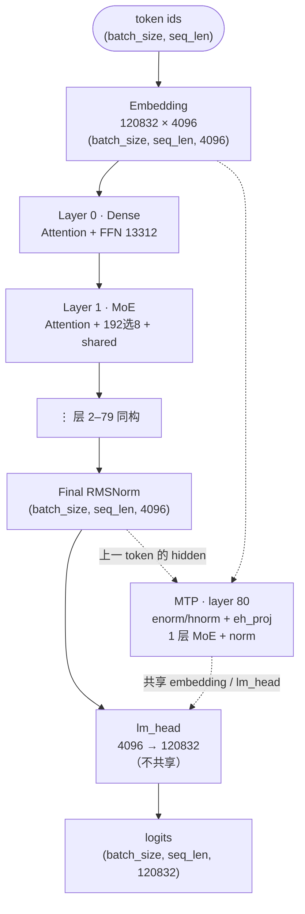

# HY3 架构

腾讯混元 **Hy3** 的 shape、参数、FLOPs、访存账本。**不下载权重**：所有数字只由本目录的
[`config.json`](config.json) 推出，脚本是 [`accounting.py`](accounting.py)（账本）和
[`shapes.py`](shapes.py)（shape 流水）。
形状流水在 [`runs/hy3_shapes.log`](runs/hy3_shapes.log)，参数/FLOPs/访存账本在
[`accounting.log`](accounting.log)。

> 口径：参数量 / FLOPs 用十进制（`1B = 10^9`，`1T = 10^12`）；字节同时给 GB（`10^9`）和 GiB（`2^30`）。
> 权重按 `bfloat16`（2 B/元素）算。attention 的 `seq_len × seq_len` 项按完整矩阵乘算，是上界；
> causal 实际约一半，文中单独注明。

## 1. 任务

Hy3 是腾讯混元 2026-07 开源的 **decoder-only 混合专家（MoE）语言模型**，做自回归文本生成：
给一段 token，预测下一个 token，接回去继续生成。官方叫「快慢思考融合」，但那是后训练 / 推理模式，
不是两套结构；80 层主干还是同一套 decoder block。

官方模型卡给的关键规格：

| 属性 | 值 |
| --- | --- |
| 架构 | decoder-only MoE |
| 总参数 / 激活参数 | 295B / 21B |
| MTP 层 | 1 层，3.8B |
| 层数（不含 MTP） | 80 |
| attention | 64 Q heads / 8 KV heads，head_dim 128（GQA） |
| hidden / dense FFN | 4096 / 13312 |
| experts | 192 选 8 + 1 shared，expert FFN 1536 |
| 上下文 / 词表 | 256K / 120832 |
| 精度 / 许可证 | BF16 / Apache-2.0 |

本文只做两件事：把 80 层 block 的 shape 走通；用 `config.json` 算参数、FLOPs、访存。
权重没下载；`config.json` 是唯一真源，改字段账本会跟着变。

### 1.1 代码从哪来

Hy3 的模型代码不在权重仓库里，已经进了 HuggingFace Transformers 上游：

| 文件 | 作用 |
| --- | --- |
| [`transformers/models/hy_v3/modular_hy_v3.py`](https://github.com/huggingface/transformers/blob/main/src/transformers/models/hy_v3/modular_hy_v3.py) | 手写源文件，最清楚 |
| [`transformers/models/hy_v3/modeling_hy_v3.py`](https://github.com/huggingface/transformers/blob/main/src/transformers/models/hy_v3/modeling_hy_v3.py) | 自动生成的可执行版本 |
| [`sglang/models/hunyuan_v3_nextn.py`](https://github.com/sgl-project/sglang/blob/main/python/sglang/srt/models/hunyuan_v3_nextn.py) | MTP（NextN）推理实现 |

模型类名 `HYV3ForCausalLM`，`model_type = "hy_v3"`。需要 `transformers >= 5.6`（config 里写的版本）。
代码不是从零写的，是一层层继承拼出来的：

```
HYV3ForCausalLM   ← LlamaForCausalLM
  HYV3Model       ← MiniMaxM2Model
    HYV3DecoderLayer ← DeepseekV3DecoderLayer     # pre-norm + 残差
      HYV3Attention  ← ApertusAttention           # GQA + QK-Norm + RoPE
      HYV3MoE        ← MiniMaxM2SparseMoeBlock
        HYV3TopKRouter ← MixtralTopKRouter        # 改成 sigmoid + bias
        HYV3Experts    ← Qwen3MoeExperts          # packed 3D 专家权重
      HYV3MLP        ← LlamaMLP                   # SwiGLU
```

所以它的结构和 DeepSeek-V3 / MiniMax-M2 / Qwen3-MoE 是同一族，不是新积木。
本文按 **config + 这份代码** 对，不按论文或记忆对。

**没有下载的东西**：`model-00001-of-00099.safetensors` 等 99 个分片，约 597.6 GB。
`config.json` 是唯一真源。

---

## 2. 记号

模型结构全在 `config.json` 里，直接用字段名，不再另起一套符号。运行时的长度也不造新符号，
沿用 GPT 那篇的 `batch_size`、`seq_len`、`q_len`、`kv_len`：

`config.json` 取自 [`tencent/Hy3`](https://huggingface.co/tencent/Hy3/raw/main/config.json)，47 行，原样放在本目录。
权重/模型卡是 Apache-2.0；Transformers 的 `hy_v3` 代码也是 Apache-2.0。

| 字段 | 值 | 含义 |
| --- | --- | --- |
| `hidden_size` | 4096 | 主干宽度 `H` |
| `num_hidden_layers` | 80 | 主干层数，**不含 MTP** |
| `num_attention_heads` | 64 | Q 头数 |
| `num_key_value_heads` | 8 | KV 头数（GQA） |
| `head_dim` | 128 | 每头维度，显式给出 |
| `intermediate_size` | 13312 | dense 层 FFN 宽度 |
| `num_experts` | 192 | 路由专家数 |
| `num_experts_per_tok` | 8 | 每 token 选 8 个 |
| `num_shared_experts` | 1 | 共享专家数 |
| `moe_intermediate_size` | 1536 | 每个专家的 FFN 宽度 |
| `first_k_dense_replace` | 1 | 第 0 层 dense，1–79 层 MoE |
| `num_nextn_predict_layers` | 1 | MTP 层数 |
| `vocab_size` | 120832 | 词表 |
| `max_position_embeddings` | 262144 | 256K 上下文 |
| `tie_word_embeddings` | false | embedding 和 lm_head 不共享 |
| `dtype` | bfloat16 | 权重 2 B/元素 |
| `rope_parameters.rope_theta` | 11158840 | RoPE base，约 1.116e7 |
| `rope_parameters.rope_type` | default | 没有 YaRN / 线性缩放 |
| `router_scaling_factor` | 2.826 | top-k 权重再乘这个数 |
| `moe_router_use_sigmoid` | true | 路由用 sigmoid，不是 softmax |
| `moe_router_enable_expert_bias` | true | top-k 选择时加 `e_score_correction_bias` |
| `route_norm` | true | top-k 权重归一化到和 = 1 |
| `qk_norm` | true | Q/K 每个头做 RMSNorm |
| `enable_moe_fp32_combine` | false | routed + shared 在 bf16 下相加 |
| `enable_lm_head_fp32` | true | 推理引擎的 lm_head fp32 开关；HF 代码里没用到 |

派生量：

```
q_dim   = 64 × 128 = 8192        # q_proj 的输出宽度，是 H 的两倍
kv_dim  =  8 × 128 = 1024        # k/v_proj 的输出宽度
group   = 64 / 8   = 8           # 每个 KV 头服务 8 个 Q 头
```

运行时的长度：

| 符号 | 值 | 来源 |
| --- | --- | --- |
| `batch_size` | 1 | 一次并行几条序列 |
| `seq_len` | 4096 | prefill 的 token 数 |
| `q_len` | `seq_len`（prefill）/ 1（decode） | 当前 forward 的 query 数 |
| `kv_len` | `seq_len`（prefill）/ 历史 + 1（decode） | K/V 的长度 |

两个容易记错的：

- `head_dim` 是 128，但 `q_dim = 8192 ≠ hidden_size = 4096`。Q 投影是**变宽**的。
- `num_key_value_heads = 8`，不是 64。KV cache 只存 8 个头。

---

## 3. 结构

### 3.1 和 Transformer / GPT 差在哪

| 零件 | Transformer 2017 | GPT-2 | **HY3** |
| --- | --- | --- | --- |
| 结构 | Enc×6 + Dec×6 | Dec×N | **Dec×80** |
| 归一化 | post-LN | pre-LN | **pre-RMSNorm** |
| 位置 | sin/cos 加到 embedding | 可学习绝对位置 | **RoPE 加到每层 Q/K** |
| 注意力 | MHA 8 头 | MHA | **GQA：64 Q / 8 KV，QK-Norm** |
| FFN | 两层 4×，ReLU | 两层 4×，GELU | **SwiGLU；dense 13312 / expert 1536** |
| 稀疏 | 无 | 无 | **MoE：192 选 8 + 1 shared** |
| 输出头 | 和 embedding 共享 | 和 embedding 共享 | **不共享**，单独 494.9M |
| 额外 | — | — | **1 层 MTP（投机解码）** |

这些零件不单独设档，直接在 HY3 的真实 config 上对。下面按 shape 走一遍。

---

### 3.2 全貌



要点：

- **80 层全部是 decoder 层**，没有 encoder、没有 cross-attn。
- 第 0 层是 dense FFN；第 1–79 层是 MoE。不是交替。
- `lm_head` 和 embedding 不共享，两个 120832×4096 矩阵各算各的。
- MTP 是第 81 层（checkpoint 里的 `model.layers.80`），只用于投机解码，
  HF 的 `HYV3ForCausalLM` 会忽略它（`_keys_to_ignore_on_load_unexpected`）。

---

### 3.3 一个 block 的 shape

下面默认 `batch_size = 1`；prefill 取 `seq_len = 4096`，decode 取 `q_len = 1`、`kv_len = 131072`。
表里以 **block 1（MoE）** 为例；block 0 是 dense，把 router/experts 换成
`gate_proj (1, seq_len, 13312)`、`up_proj (1, seq_len, 13312)`、`down_proj (1, seq_len, 4096)`。
HY3 的 Linear 没有 bias（`attention_bias=false`、`mlp_bias=false`），所以只写 `W`，不写 `+ b`。

#### 3.3.1 prefill（一次喂 seq_len 个 token）

| 操作 | shape | 说明 |
| --- | --- | --- |
| `x` | `(1, seq_len, 4096)` | 上一层输出 |
| `input_layernorm` | `(1, seq_len, 4096)` | RMSNorm，每 token 独立 |
| `q_proj` | `(1, seq_len, 8192)` | `x @ Wqᵀ(4096, 8192)` |
| `k_proj` / `v_proj` | `(1, seq_len, 1024)` | `x @ Wkᵀ / Wvᵀ(4096, 1024)` |
| `q` 拆头 | `(1, 64, seq_len, 128)` | `view(1, seq_len, 64, 128)` 后 `.transpose(1, 2)` |
| `k` / `v` 拆头 | `(1, 8, seq_len, 128)` | 同上（KV 头 8 个） |
| `q_norm` / `k_norm` | `(1, 64, seq_len, 128)` / `(1, 8, seq_len, 128)` | 最后一维 128 上做 RMSNorm |
| RoPE | 不变 | 只作用在 Q/K，不作用 V |
| `repeat_kv` | `(1, 64, seq_len, 128)` | 概念上每个 KV 头复制 8 份 |
| `scores = q @ kᵀ` | `(1, 64, seq_len, seq_len)` | 除以 `√128`，加 causal mask |
| `softmax` | `(1, 64, seq_len, seq_len)` | 最后一维归一化 |
| `attn @ V` | `(1, 64, seq_len, 128)` | 加权求和 |
| 拼头 | `(1, seq_len, 8192)` | 64×128 拼回 8192 |
| `o_proj` | `(1, seq_len, 4096)` | `拼接结果 @ Woᵀ(8192, 4096)` |
| `+ residual` | `(1, seq_len, 4096)` | 逐元素 |
| `post_attention_layernorm` | `(1, seq_len, 4096)` | 第二个 RMSNorm |
| `x` flatten | `(seq_len, 4096)` | MoE 按 token 路由 |
| `router` | `(seq_len, 192)` | `x @ W_rᵀ(4096, 192)`，fp32 |
| `top-k` | `(seq_len, 8)` | 选 8 个专家 |
| 每个专家 `gate_up` | `(n_e, 3072)` | `x_e @ W_gu[e]ᵀ(4096, 3072)`；`n_e ≈ seq_len × 8 / 192` |
| 每个专家 `down` | `(n_e, 4096)` | `h_e @ W_d[e]ᵀ(1536, 4096)` |
| shared expert | `(seq_len, 1536) → (seq_len, 4096)` | `x @ W_gateᵀ / W_upᵀ(4096, 1536) → W_downᵀ(1536, 4096)` |
| 合并 | `(seq_len, 4096) → (1, seq_len, 4096)` | `routed + shared` |
| `+ residual` | `(1, seq_len, 4096)` | 第二层残差 |

> **拆头不是 `reshape`。** `view(1, seq_len, 64, 128)` 只是把 8192 拆成 `64 × 128`；
> 还要 `.transpose(1, 2)` 把 `heads` 挪到 `seq_len` 前面，才是 `(1, 64, seq_len, 128)`。
> 只 reshape 不 transpose，`scores` 的头维和序列维会对错。

`seq_len = 4096` 时，`scores` 是 `(1, 64, 4096, 4096)`，约 **10.7 亿个数**，bf16 要 **2.1 GB**
—— 一层就这么多。所以真实的 attention 不会把 `scores` 写出来，用 FlashAttention
分块算；这里列形状是为了理解，不是为了真分配。

#### 3.3.2 decode（每次 1 个 token，带 KV cache）

| 操作 | shape | 说明 |
| --- | --- | --- |
| `x` | `(1, 1, 4096)` | 新 token |
| `q_proj` | `(1, 1, 8192)` → `(1, 64, 1, 128)` | `x @ Wqᵀ(4096, 8192)`，只有 1 个位置 |
| `k_proj` / `v_proj` | `(1, 1, 1024)` → `(1, 8, 1, 128)` | `x @ Wkᵀ / Wvᵀ(4096, 1024)`，只有新 token |
| KV cache 追加 | `(1, 8, kv_len, 128)` | `kv_len` = 历史 + 当前 |
| `repeat_kv` | `(1, 64, kv_len, 128)` | 概念上 |
| `scores` | `(1, 64, 1, kv_len)` | q_len = 1，kv_len = 历史 + 1 |
| `softmax` | `(1, 64, 1, kv_len)` | 每个 Q 对全部历史归一化 |
| `attn @ V` | `(1, 64, 1, 128)` | 加权求和 |
| `o_proj` | `(1, 1, 4096)` | `拼接结果 @ Woᵀ(8192, 4096)` |
| MoE | `(1, 4096) → (1, 4096)` | 1 个 token 选 8 个专家；block 0 换成 dense FFN |
| `lm_head` | `(1, 1, 120832)` | `y @ Wᵀ(4096, 120832)`，只取最后一个位置 |

decode 和 prefill 的差别只有三处：

1. `q_len = 1`，不是 `seq_len`；
2. `k/v` 不再重新投影整段，而是从 cache 读；
3. `scores` 是 `1 × kv_len`，不是 `seq_len × seq_len`。

**这就是为什么推理要分两阶段**：prefill 的矩阵乘很大、能跑满算力；
decode 的矩阵乘退化成矩阵-向量，瓶颈从算力换成带宽。

#### 3.3.3 GQA：64 个 Q 头，8 个 KV 头

```
Q: 64 头 × 128 维 = 8192
K:  8 头 × 128 维 = 1024
V:  8 头 × 128 维 = 1024
            │
            ├─ 每个 KV 头被 8 个 Q 头共享
            └─ scores 仍然是 64 头： (1, 64, seq_len, kv_len)
```

GQA 省的不是 `scores` 的 FLOPs（还是 64 头），省的是：

- `k_proj` / `v_proj` 的权重：1024 输出而不是 8192，各省 8 倍；
- **KV cache**：只存 8 个头，不是 64 个，省 8 倍；
- decode 时读 KV 的字节数，省 8 倍。

如果按 64 个 KV 头（MHA）算，KV cache 会是 `2 × 64 × 128 × 2 B = 32 KiB`
每层每 token；HY3 是 `2 × 8 × 128 × 2 B = 4 KiB`。80 层差 8 倍：
**2.5 MiB vs 320 KiB per token**。

#### 3.3.4 QK-Norm + RoPE

Q/K 投影之后、RoPE 之前，每个头在 128 维上做一次 RMSNorm：

```
q: (1, 64, seq_len, 128) → 每个头独立归一化 → (1, 64, seq_len, 128)
k: (1,  8, seq_len, 128) → 每个头独立归一化 → (1,  8, seq_len, 128)
```

- 参数只有 `q_norm.weight` + `k_norm.weight` = 2×128 = **256 个/层**；
- 作用：稳住 attention logits 的尺度，长上下文/低精度训练更稳；
- 然后才做 RoPE：`rope_theta = 11,158,840`，`rope_type = default`，
  作用在 128 维的**全部维度**上（不是 partial rotary）。

RoPE 不改变 shape，只旋转 Q/K 的每对维度：

```
q'_{2i}   = q_{2i} cosθ − q_{2i+1} sinθ
q'_{2i+1} = q_{2i} sinθ + q_{2i+1} cosθ
```

V 不做 RoPE。位置信息只通过 Q/K 的点积进入 attention。

#### 3.3.5 RMSNorm + 残差

每个 decoder 层两个 RMSNorm，最后再一个 final norm：

```
residual = x
x = input_layernorm(x)          # pre-norm
x = self_attn(x)
x = residual + x

residual = x
x = post_attention_layernorm(x) # pre-norm
x = mlp(x)
x = residual + x
```

- pre-norm：归一化在子层**之前**，残差在子层**之外**；
- 没有 post-LN，没有 dropout，没有 bias；
- 每个 RMSNorm 4096 个 γ，80 层 × 2 + final = **659,456 个参数**，
  相对 295B 可以忽略。

---

### 3.4 MoE

#### 3.4.1 router：sigmoid + bias + 归一化 + 2.826

每个 token 的 4096 维向量，过一个小矩阵 `W_r`（192×4096，**fp32**）：

```
logits = x @ W_rᵀ                  # (seq_len, 192)
p      = sigmoid(logits)           # 不是 softmax
s      = p + e_score_correction_bias   # 192 个 buffer，只影响“选谁”
idx    = topk(s, 8)                # (seq_len, 8)
w      = p.gather(idx)             # 注意：用 p，不用 s
w      = w / sum(w)                # route_norm：8 个权重和 = 1
w      = w * 2.826                 # router_scaling_factor
```

四个细节：

- **sigmoid 不是 softmax**：每个专家独立打分，不互相竞争；
- **bias 只参与选择**：`s` 用来 top-k，真正拿去做加权的是 `p`；
- **归一化后再乘 2.826**：所以 8 个权重加起来是 2.826，不是 1；
- `e_score_correction_bias` 是 **buffer**，不是参数，也不进梯度；
  HF 的 forward 里 `aux_loss=None`，负载均衡靠训练侧更新这个 bias。

#### 3.4.2 专家：192 个，每个 1536 宽

每个专家是一个 SwiGLU：

```
gate_up = x_e @ W_gu[e]ᵀ      # (n_e, 3072) = 1536 gate + 1536 up
gate, up = chunk(gate_up, 2)
h = silu(gate) * up            # (n_e, 1536)
y_e = h @ W_d[e]ᵀ              # (n_e, 4096)
out[token] += y_e * w          # 按路由权重加权
```

- `W_gu` 打包成 `(192, 3072, 4096)`，`W_d` 打包成 `(192, 4096, 1536)`；
- 每个专家 **18,874,368** 个参数（= 3 × 4096 × 1536）；
- 192 个专家一层 **3,623,878,656** 个参数（3.62B）；
- 一个 token 只算 top-8，即 **150,994,944** 个专家参数（151M），
  不是 3.62B。

`n_e` 是分到专家 `e` 的 token 数。理想均匀时 `n_e = seq_len × 8 / 192 = seq_len / 24`；
`seq_len = 4096` 时约 171 个 token/专家。

#### 3.4.3 shared expert：永远算的那一个

除了 192 个路由专家，每层还有 **1 个 shared expert**：

```
y_s = down(silu(gate(x)) * up(x))    # (seq_len, 4096)
```

- 中间宽度也是 1536，参数 18,874,368/层；
- 所有 token 都过它，不参与路由；
- 作用：给 routed experts 一个稳定的“公共底座”，减少路由波动。

#### 3.4.4 一层 MoE 的账

| 部分 | 参数量 | 每 token 激活 |
| --- | --- | --- |
| attention（Q/K/V/O + QK-Norm） | 75,497,728 | 75,497,728 |
| 192 个 routed experts | 3,623,878,656 | 8 × 18,874,368 = 150,994,944 |
| shared expert | 18,874,368 | 18,874,368 |
| router | 786,432 | 786,432 |
| 2 × RMSNorm | 8,192 | 8,192 |
| **一层合计** | **3,719,045,376** | **246,161,664** |

一层总参数是激活参数的 **15.1 倍**（3.719B / 246M）。
整个模型是 **14.27 倍**（295.03B / 20.68B）——
因为第 0 层是 dense，embedding/lm_head 也一直“激活”。

---

### 3.5 MTP：第 81 层

config 里 `num_nextn_predict_layers = 1`。checkpoint 里它是 `model.layers.80`，
HF 的 `HYV3ForCausalLM` 不加载（`_keys_to_ignore_on_load_unexpected = [r"model\.layers\.80.*"]`），
vLLM / SGLang 在投机解码时才用它。

结构（来自 SGLang `hunyuan_v3_nextn.py`）：

```
token emb          (1, 1, 4096) ── enorm ─┐
上一 token hidden  (1, 1, 4096) ── hnorm ─┤
                                          ├─ cat → (1, 1, 8192)
                                          └─ eh_proj (8192 → 4096)
                                               → 1 层 MoE decoder
                                               → shared_head.norm
                                               → 共享 lm_head
```

参数：

| 部分 | 参数量 |
| --- | --- |
| 1 层 MoE decoder（同 1–79 层） | 3,719,045,376 |
| `eh_proj`（8192×4096） | 33,554,432 |
| `enorm` + `hnorm` + `shared_head.norm` | 3 × 4096 = 12,288 |
| **MTP 合计** | **3,752,612,096（3.75B）** |

它**不额外占 embedding / lm_head**：这两个和主干共享。所以 checkpoint 只多 3.75B，
不是 3.75B + 1B。

每个 draft token 只激活 **279,728,384** 个参数（约 280M），
读 **559 MB** 权重；相对主干的 40.36 GB/token 只多 **1.4%**。
这是 MTP 便宜的原因：它只有 1 层，且共享词表矩阵。

---

## 4. 参数

### 4.1 公式

记：

```
H  = 4096          hidden_size
I  = 13312         dense intermediate_size
Im = 1536          moe_intermediate_size
V  = 120832        vocab_size
E  = 192           num_experts
K  = 8             num_experts_per_tok
L  = 80            num_hidden_layers
Hq = 64 × 128 = 8192
Hkv=  8 × 128 = 1024
```

一层 attention：

```
attn = H×Hq + 2×H×Hkv + Hq×H + 2×head_dim
     = 4096×8192 + 2×4096×1024 + 8192×4096 + 256
     = 75,497,728
```

dense FFN（第 0 层）：

```
mlp_dense = 3 × H × I = 3 × 4096 × 13312 = 163,577,856
```

一个专家 / 一层 MoE：

```
expert     = 3 × H × Im = 3 × 4096 × 1536 = 18,874,368
experts    = E × expert = 192 × 18,874,368 = 3,623,878,656
shared     = 1 × expert = 18,874,368
router     = E × H = 192 × 4096 = 786,432
moe_layer  = attn + experts + shared + router + 2×H
           = 3,719,045,376
```

主干：

```
main = layer0 + 79 × moe_layer + 2 × V×H + H
     = 239,083,776 + 293,804,584,704 + 989,855,744 + 4,096
     = 295,033,528,320
```

MTP：

```
mtp = moe_layer + 2×H×H + 3×H
    = 3,719,045,376 + 33,554,432 + 12,288
    = 3,752,612,096
```

### 4.2 账本

| 部分 | 公式 | 每层 / 每个 | 数量 | 合计 |
| --- | --- | --- | --- | --- |
| attention | Q/K/V/O + QK-Norm | 75,497,728 | 80 层 | 6,039,818,240 |
| dense FFN | `3HI` | 163,577,856 | 1 层 | 163,577,856 |
| routed experts | `E × 3HIm` | 3,623,878,656 | 79 层 | 286,286,413,824 |
| shared expert | `3HIm` | 18,874,368 | 79 层 | 1,491,075,072 |
| router | `EH` | 786,432 | 79 层 | 62,128,128 |
| RMSNorm | `2H` | 8,192 | 80 层 | 655,360 |
| embedding | `VH` | — | 1 | 494,927,872 |
| lm_head（不共享） | `VH` | — | 1 | 494,927,872 |
| final norm | `H` | — | 1 | 4,096 |
| **主干合计** | | | | **295,033,528,320** |
| MTP | 1 层 MoE + eh_proj + 3 norm | — | 1 | 3,752,612,096 |
| **checkpoint 合计** | | | | **298,786,140,416** |

### 4.3 两种算法对账

这是全文最重要的一次校验：

| 口径 | 值 | 差 |
| --- | --- | --- |
| 本文主干 | 295,033,528,320 | — |
| 官方「295B」 | 295,000,000,000 | **+0.011%** |
| 本文含 MTP | 298,786,140,416 | — |
| HF safetensors BF16 计数 | 298,786,140,416 | **0** |

逐位相等说明：

- 80 层、192 专家、top-8、1 shared、GQA 8 头、head_dim 128 这些字段没有抄错；
- MTP 确实只有 1 层，且没有重复算 embedding / lm_head；
- `tie_word_embeddings = false` 是对的（否则会少 494,927,872）。

HF 元数据里还有 15,360 个 F32 张量：`192 × 80 = 15,360`，正是每层 192 个
`e_score_correction_bias`（buffer，不算参数）。

### 4.4 激活参数

| 部分 | 参数量 | 占比 |
| --- | --- | --- |
| attention（80 层） | 6,039,818,240 | 29.21% |
| top-8 routed experts（79 层） | 11,928,600,576 | 57.69% |
| shared expert（79 层） | 1,491,075,072 | 7.21% |
| dense FFN（layer 0） | 163,577,856 | 0.79% |
| embedding + lm_head | 989,855,744 | 4.79% |
| router（79 层） | 62,128,128 | 0.30% |
| RMSNorm | 659,456 | 0.003% |
| **激活合计** | **20,675,715,072** | **100%** |

官方写「21B 激活」，精确值是 **20.68B**，四舍五入对得上。
总参数 : 激活 = **14.27 : 1**。

注意：这里的「激活参数」按**每个 token 参与的权重**算，包含 embedding 和 lm_head。
真正做矩阵乘时，embedding 只是查表（0 FLOPs），lm_head 是一个 `4096×120832` 的矩阵乘。
所以 **2 × 激活参数** 会略微高估 FLOPs，下一节会用这个关系做校验。

---

## 5. 计算量（FLOPs）

### 5.1 规则

> 单位：`G = 10⁹`、`T = 10¹²`（和厂商标的 TFLOPs 一致）。手算时凑 1024 记 K 只是为了快，不影响这里的读法。

```
矩阵乘 (m,k) @ (k,n) → 2mkn FLOPs        # 乘加算两次
一个 SwiGLU 专家     → 6 × H × Im FLOPs/token
RMSNorm             → ~5 FLOPs/元素
softmax             → ~5 FLOPs/score
RoPE                → ~6 FLOPs/元素
```

MoE 只算 **top-8 + shared**，不算另外 184 个专家。这是全文最容易算错的地方。

手算一个算子（`q_proj`，`seq_len = 4096`）：

```
m = 4096（token）, k = 4096, n = 8192
4096 × 4096 × 8192
= 4096 × 33.55M          ← 4096 × 8192 = 33.55M
= 137.4G 次乘加
× 2 = 274.9G FLOPs
```

四个投影（q/k/v/o）加起来约 `618G`，和 §5.2 的 `618.475G` 对得上。

### 5.2 prefill：`seq_len = 4096`

| 部分 | 每层 | × 层数 | 合计 |
| --- | --- | --- | --- |
| layer 0（dense） | 2.514 T | 1 | 2.514 T |
| MoE 层 | 2.572 T | 79 | 203.218 T |
| lm_head | 4.054 T | 1 | 4.054 T |
| **合计** | | | **209.787 T FLOPs** |

平均每 token：**51.218 G FLOPs**。

MoE 层拆开（`seq_len = 4096`）：

| 子项 | FLOPs | 占比 |
| --- | --- | --- |
| attention Q/K/V/O | 618.475 G | 24.0% |
| scores + attn@V | 549.756 G | 21.4% |
| top-8 experts | 1.237 T | 48.1% |
| shared expert | 154.619 G | 6.0% |
| router | 6.442 G | 0.25% |
| QK-Norm / RoPE / softmax / RMSNorm | ~5.97 G | 0.23% |
| **合计** | **2.572 T** | **100%** |

三条能直接记住的：

- **MoE 的专家占一半**（1.237T / 2.572T ≈ 48%），attention 占 45%；
- **router 很便宜**（0.25%），贵的是被选中的专家；
- 序列短时 `seq_len × seq_len` 项小；`seq_len = 4096` 时它已经占 attention 的 47%。

### 5.3 decode：1 token，上下文 `kv_len = 131072`

| 部分 | 每层 | × 层数 | 合计 |
| --- | --- | --- | --- |
| layer 0（dense） | 4.815 G | 1 | 4.815 G |
| MoE 层 | 4.829 G | 79 | 381.523 G |
| lm_head | 0.990 G | 1 | 0.990 G |
| **合计** | | | **387.328 G FLOPs/token** |

MoE 层拆开：

| 子项 | FLOPs | 说明 |
| --- | --- | --- |
| Q/K/V/O | 150.995 M | 只算新 token |
| scores + attn@V | 4.295 G | `4 × kv_len × 64 × 128` |
| top-8 experts | 301.990 M | 8 × 6×H×Im |
| shared expert | 37.749 M | 6×H×Im |
| router | 1.573 M | `2×H×E` |
| QK-Norm / RoPE / softmax / RMSNorm | ~42 M | 零头 |
| **合计** | **4.829 G** | |

关键对比：

- `kv_len = 0` 时，decode 是 **40.375 G FLOPs/token**；
- `kv_len = 131072` 时，涨到 **387.328 G**，其中 **343.6 G 是 attention 的 kv_len 项**（88.7%）；
- `kv_len = 262144` 时，涨到 **734.281 G**，attention kv_len 项占 **93.6%**。

所以长上下文 decode 的 FLOPs 看起来是 attention 主导，但它仍然是**带宽瓶颈**
（见 6.4）：读 KV 的字节涨得一样快，算术强度只有 4.65（128K）/ 5.81（256K），
远低于 H20 的 37。

### 5.4 校验：`2 × 激活参数`

| 口径 | decode `kv_len=0` | prefill `seq_len=4096` |
| --- | --- | --- |
| `2 × (激活参数 − embedding)` | 40.362 G | 165.321 T |
| 逐算子求和 | 40.375 G | 209.787 T |
| 差 | +0.013 G（0.03%） | +44.466 T（26.9%） |

decode 的差只有 norm / softmax 的零头，两条路对上。
prefill 的差是 **attention 的 `seq_len × seq_len` 项 + softmax**：`seq_len = 4096` 时约 44.47T。
这也说明：

> 短序列用「2 × 激活参数」估 FLOPs 很准；长序列必须单独加 `seq_len × seq_len`。

### 5.5 如果它是 dense 模型

```
dense 每 token = 2 × 295.03B = 590.07 G FLOPs
HY3 每 token   = 40.36 G（kv_len=0）
                → 14.6 倍差距
```

prefill `seq_len=4096`：

```
dense = 2 × 295.03B × 4096 = 2.417 P FLOPs
HY3   = 209.787 T
      → 11.5 倍差距（attention 平方项吃掉了优势）
```

MoE 省的是**权重读取和专家计算**，不省 attention。上下文越长，省得越少。

---

## 6. 访存

### 6.1 权重

| 场景 | 读什么 | 字节 |
| --- | --- | --- |
| prefill（长 seq_len） | 全部 192 个专家 + 全部主干 | **590.07 GB** |
| prefill，lm_head 按 fp32 | 同上，lm_head 4 B/元素 | 591.06 GB |
| decode 1 token | 只读 top-8 + shared + attention + lm_head | **40.36 GB** |
| decode，lm_head 按 fp32 | 同上，lm_head 4 B/元素 | 41.35 GB |
| 含 MTP 权重（常驻） | 主干 + 1 层 MTP | 597.57 GB |

prefill 为什么读全部专家：`seq_len = 4096`、每 token 选 8 个，共 32,768 次选择，
192 个专家几乎必然全部被命中。decode 只处理 1 个 token，只读 8 个专家，
所以权重流量从 590 GB 掉到 40 GB —— **14.6 倍**，和 FLOPs 的降幅一致。

decode 的 40.36 GB 具体是：

```
layer 0（dense）                       0.478 GB
79 × MoE 层激活（246.16M × 2B）       38.894 GB
embedding（只读一行 4096 × 2B）        0.000008 GB
final norm                             0.000008 GB
lm_head（494.93M × 2B）                0.990 GB
                                      ─────────
                                      40.362 GB
```

> router 的 `gate.weight` 在 HF 里是 `_keep_in_fp32_modules_strict`。如果运行时真的按 fp32 存，
> 79 层多 `79 × 786,432 × 2 B ≈ 124 MB`（0.3%），上面的账忽略了这个零头。

### 6.2 KV cache

每个 token、每层、每个 KV 头存 K 和 V 各 128 维：

```
每层每 token = 2 × 8 × 128 × 2 B = 4,096 B = 4 KiB
80 层        = 320 KiB/token
```

| kv_len | KV 大小 | 备注 |
| --- | --- | --- |
| 1K | 320 MiB | 0.335 GB |
| 8K | 2.5 GiB | 2.684 GB |
| 32K | 10 GiB | 10.737 GB |
| 64K | 20 GiB | 21.475 GB |
| 128K | **40 GiB** | 42.950 GB |
| 256K | **80 GiB** | 85.899 GB |

几个直接后果：

- KV 随 kv_len **线性**涨，权重不变；长上下文服务的显存主要被 KV 吃；
- batch 32、128K 上下文 = `32 × 40 GiB = 1.25 TiB` KV，必须 TP/PP 分片；
- TP=8 时每个 GPU 只存 1 个 KV 头，KV 也除以 8：
  256K 单序列每 GPU 10 GiB。

### 6.3 激活

decode 一个 token 的激活读写粗估 **19.3 MB**，相对 40.36 GB 权重是 0.05%，可以忽略。

prefill 的激活粗估：

| seq_len | 激活读写（未融合上界） | 相对权重 |
| --- | --- | --- |
| 1024 | 19.8 GB | 3.4% |
| 4096 | 79.2 GB | 13.4% |
| 16384 | 316.8 GB | 53.7% |
| 131072 | 2.53 TB | 4.3× |

这个数假设每个中间张量都写回 HBM 再读出来（未融合）。真实 kernel 会融合
QKV、MLP、FlashAttention，实际远低于此。它的用途是给一个**上界**：
即使按这个上界，prefill 在 `seq_len ≥ 1024` 时仍然是算力瓶颈，结论不变。

### 6.4 算术强度与 roofline

以 **8×H20-3e** 为例（BF16 148 TFLOPS/卡，4.0 TB/s/卡）：

```
峰值算力 = 8 × 148 = 1.184 PFLOP/s
峰值带宽 = 8 × 4.0 = 32 TB/s
算力/带宽 = 1.184P / 32T = 37 FLOP/B
显存     = 8 × 96 GB = 768 GB
```

**prefill**（权重全读，激活按未融合上界）：

| seq_len | FLOPs | Bytes | 算术强度 | t_mem | t_compute@40% MFU |
| --- | --- | --- | --- | --- | --- |
| 256 | 10.510 T | 595.1 GB | 17.66 | 18.6 ms | 22.2 ms |
| 1024 | 44.120 T | 610.2 GB | 72.30 | 19.1 ms | 93.2 ms |
| 4096 | 209.787 T | 670.6 GB | 312.83 | 21.0 ms | 443.0 ms |
| 16384 | 1.372 P | 912.2 GB | 1504 | 28.5 ms | 2.90 s |
| 131072 | 50.768 P | 3.167 TB | 16028 | 99.0 ms | 107.2 s |

分界点在 `seq_len ≈ 512`：

- `seq_len = 256`：算术强度 17.7 < 37，**带宽瓶颈**；
- `seq_len = 1024`：72.3 > 37，**算力瓶颈**；
- `seq_len ≥ 4096`：远大于 37，算力绝对主导。

**decode**（只读 top-8，KV 随 kv_len 涨）：

| kv_len | FLOPs/token | Bytes/token | 算术强度 | t_mem | tok/s 上限（batch 1） |
| --- | --- | --- | --- | --- | --- |
| 0 | 40.375 G | 40.381 GB | **1.00** | 1.26 ms | 792 |
| 1K | 43.086 G | 40.716 GB | 1.06 | 1.27 ms | 786 |
| 8K | 62.060 G | 43.065 GB | 1.44 | 1.35 ms | 743 |
| 32K | 127.114 G | 51.118 GB | 2.49 | 1.60 ms | 626 |
| 64K | 213.852 G | 61.856 GB | 3.46 | 1.93 ms | 517 |
| 128K | 387.328 G | 83.331 GB | 4.65 | 2.60 ms | 384 |
| 256K | 734.281 G | 126.280 GB | 5.81 | 3.95 ms | 253 |

说明：

- `tok/s 上限` = 32 TB/s ÷ Bytes/token，是**理论带宽上限**，不含 TP 通信、调度、采样；
- 实际按 50% 带宽效率估，上表除以 2；
- decode 的算术强度从 1.00 涨到 5.81，但始终 < 37，**任何上下文长度下都是带宽瓶颈**；
- 为什么 `kv_len=0` 恰好是 1.00：BF16 权重每字节对应 2 FLOPs 的矩阵乘，
  而每 token 的 FLOPs 又约等于 `2 × 激活参数`。这是 MoE decode 的常态。

**batching 的收益**：decode 一步的权重读取（40.36 GB）由整个 batch 共享，
batch 越大，每 token 摊到的权重流量越小；KV 读取则随 batch 线性涨。
所以短上下文适合大 batch，长上下文先被 KV 显存卡住。

---

## 7. 部署含义

### 7.1 显存

```
主干权重          590.07 GB
MTP 权重            7.51 GB
                  ─────────
BF16 合计         597.57 GB / 556.53 GiB
```

TP=8 时每卡权重：

```
597.57 / 8 = 74.70 GB = 69.56 GiB
```

| 机器 | 单卡显存 | 8 卡总显存 | 权重后剩余 | 256K KV（每卡） | 余量（每卡） |
| --- | --- | --- | --- | --- | --- |
| 8×H20-3e | 96 GB | 768 GB | 170.4 GB | 10.74 GB | 10.56 GB |
| 8×H100 80GB | 80 GB | 640 GB | 42.4 GB | 10.74 GB | **−5.44 GB，装不下** |
| 8×H200 141GB | 141 GB | 1128 GB | 530.4 GB | 10.74 GB | 55.56 GB |

H100 80GB 的账：

```
每卡权重 74.70 GB + 256K KV 10.74 GB = 85.44 GB > 80 GB
128K KV 5.37 GB + 74.70 GB = 80.07 GB，仍然贴着上限
64K KV 2.68 GB + 74.70 GB = 77.38 GB，只剩 2.62 GB
```

所以官方推荐 H20-3e（96 GB）而不是 H100 80GB。8×H100 80GB 在 TP=8 下
最多跑约 64K 上下文，且只剩 2.6 GB 余量；想上 256K，需要 H20/H200 或更多卡。

### 7.2 8×H20-3e 的粗估

| 场景 | 估算 | 说明 |
| --- | --- | --- |
| decode `kv_len=0` | 1.26 ms/token → 792 tok/s | 100% 带宽，batch 1 |
| decode `kv_len=128K` | 2.60 ms/token → 384 tok/s | 100% 带宽，batch 1 |
| decode `kv_len=256K` | 3.95 ms/token → 253 tok/s | 100% 带宽，batch 1 |
| prefill `seq_len=1024` | 93 ms | 40% MFU，算力瓶颈 |
| prefill `seq_len=4096` | 443 ms | 40% MFU，算力瓶颈 |

这些是**上限/量级**，不是 vLLM/SGLang 的实测。真实数字会被 TP 通信、
MoE all-to-all、路由不均衡、采样、调度拉低。L3b 要上真机才能填。

### 7.3 这台机器

```
Apple M4 / 16 GB / arm64 / 无 CUDA / MPS
```

装不下：

```
整模型 BF16        597.57 GB   → 需要 16 GB 的 37 倍
一层 MoE           7.44 GB     → 一层能放下，但 80 层不行
4-bit 量化          约 149 GB   → 仍然 9 倍
```

所以 HY3 的 L2 / L3b 在本机做不了。能做的只有：

- **L1**：架构图 + shape（本文）；
- **L3a**：纸面参数 / FLOPs / 访存（本文 + `accounting.py`）；
- 用 tiny config 跑一遍同构代码，验证 shape 和公式（见「附：下一步」）。

---

## 8. 易错点

1. **80 层不是 81 层。** 主干 80 层；checkpoint 里多出的 `layers.80` 是 MTP。
2. **295B 不是 checkpoint 大小。** 295B 是主干；含 MTP 是 298.79B，和 safetensors 对上。
3. **21B 激活是约数。** 精确值 20.68B，包含 embedding 和 lm_head。
4. **192 个专家不是每 token 都算。** 只算 top-8 + 1 shared；算 FLOPs 时用 9 个。
5. **`head_dim=128` 是显式字段。** `q_dim = 8192`，不是 4096；`o_proj` 是 8192→4096。
6. **KV 头是 8 个，不是 64 个。** KV cache 每层每 token 4 KiB，不是 32 KiB。
7. **`vocab_size=120832`。** 不是 128K；embedding 和 lm_head 不共享。
8. **RoPE theta 是 11,158,840。** 不是 10,000 / 500,000；`rope_type=default`，没有 YaRN。
9. **router 是 sigmoid，不是 softmax。** 还有 bias、归一化、×2.826。
10. **bias 只影响 top-k 选择。** 加权用的是 sigmoid 后的 `p`，不是 `p+bias`。
11. **`first_k_dense_replace=1`。** 只有第 0 层 dense；HF 用 `mlp_layer_types` 得到同样结果。
12. **`enable_lm_head_fp32` 是推理引擎开关。** HF 的 modeling 代码里没用到；只影响 lm_head 的字节/算力。
13. **MTP 不被 HF 加载。** `model.layers.80.*` 在 ignore 列表里；投机解码要用 vLLM/SGLang。
14. **`e_score_correction_bias` 是 buffer。** 不是参数；checkpoint 里 15,360 个 F32 张量就是它。
15. **`expert_hidden_dim` 和 `moe_intermediate_size` 都是 1536。** 代码用后者，前者是别名。
16. **长上下文不要 materialize scores。** 128K 时一层 scores 是 `(1,64,131072,131072)`，约 1.1 万亿个数，2.2 TB；必须 FlashAttention。
17. **prefill 和 decode 的权重流量不同。** prefill 读全部专家（590 GB），decode 只读 top-8（40 GB）。
18. **decode 看字节，不看 FLOPs。** 算术强度约 1，任何 GPU 上都是带宽瓶颈。

---

## 9. 一句话总结

| 项 | 值 | 来源 |
| --- | --- | --- |
| 总参数（主干，不含 MTP） | **295,033,528,320（295.03B）** | 逐模块求和，和官方「295B」对上 |
| MTP 层参数 | **3,752,612,096（3.75B）** | 官方写 3.8B |
| checkpoint 参数（含 MTP） | **298,786,140,416（298.79B）** | 和 HF safetensors 的 BF16 计数**逐位相等** |
| 激活参数 / token | **20,675,715,072（20.68B）** | 官方写 21B |
| 总参数 : 激活参数 | **14.27 : 1** | 192 个专家只开 8 个 + 1 个 shared |
| 权重（BF16，主干） | **590.07 GB / 549.54 GiB** | 295.03B × 2 B |
| 权重（BF16，含 MTP） | **597.57 GB / 556.53 GiB** | 298.79B × 2 B |
| decode 每 token 读权重 | **40.36 GB** | 只读 top-8 专家，不读全部 192 个 |
| KV cache / token | **320 KiB**（每层 4 KiB） | 80 层 × 2 × 8 KV heads × 128 |
| 256K 上下文 KV | **80 GiB** | 262,144 × 320 KiB |
| decode 算术强度（kv_len=0） | **1.00 FLOP/B** | 40.38G FLOPs ÷ 40.38GB |
| 8×H20-3e 显存 | 768 GB，权重占 597.57 GB | 剩 170.4 GB 给 KV / 激活 |

> **这是一个 295B 总参数、20.7B 激活、80 层、每层 192 选 8 的 MoE；
decode 每 token 只搬约 40 GB 权重，算术强度约 1，天然带宽瓶颈。**

---

## 附：复现

```bash
# 1) shape 流水：只按 config 推形状，不加载权重
python llm/hy3/shapes.py
# → llm/hy3/runs/hy3_shapes.log

# 2) 参数 / FLOPs / 访存账本
python llm/hy3/accounting.py
# → llm/hy3/accounting.log

# 换账本参数
python llm/hy3/accounting.py --prefill 1024 --context 32768 --hardware h100x8
```

`shapes.py` 和 `accounting.py` 都只读 `config.json`，不 import torch，不联网，不加载权重。
改 config 里的任何字段，shape 流水和账本会跟着变；这是它作为「唯一真源」的用法。
L2 的真实权重前向跑不了（597.6 GB），`hy3_shapes.log` 是用真实 config 维度做的 shape 推演。

---

## 附：下一步

- [x] `config.json` + 代码来源
- [x] shape 流水：`shapes.py` → `runs/hy3_shapes.log`
- [x] 参数量账本（和 298.79B 逐位对上）
- [x] FLOPs / 访存 / KV cache
- [x] 架构与 shape 文档
- [ ] tiny config 跑通同构代码（可选）：`hidden_size=64, num_hidden_layers=3, num_experts=8, num_experts_per_tok=2`
- [ ] L3b：8×H20-3e 上跑 vLLM/SGLang，填实测列
- [ ] 和 HY3-FP8 的权重/访存对比（FP8 约 299 GB）
- [ ] HY4 / HY4-Flash
