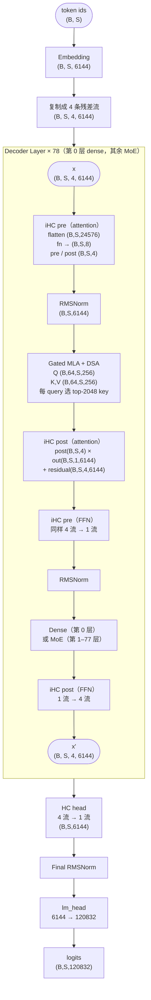

# HY4 架构与账本

> 对象：`tencent/Hy4`（正式版，2026-11-20 权重）。
> 方法：只读 `config.json` 和 vLLM / transformers 的建模代码，**不下载权重**。
> 结论：**774.434B checkpoint（770B text + 1.23B ViT + 3.3B DFly2）/
> 49B text active / 78 层 / 1M context**。本机只能做 L1 + L3a，L2 不可行。

## 0. 先回答三个问题

**能搜到代码吗？** 能，而且不止一份：

| 位置 | 内容 |
| --- | --- |
| `huggingface/transformers` → `src/transformers/models/hy_v4/` | 文本主干参考实现（`HYV4ForCausalLM`） |
| `vllm-project/vllm` → `vllm/models/hy_v4/` | 推理实现：MLA / DSA / iHC / MoE / VL / DFly |
| `sgl-project/sglang` → `python/sglang/srt/models/hunyuan_v4.py` | 另一份推理实现，可交叉对照 |
| `Tencent-Hunyuan/Hy4` | 官方仓库：微调、部署、DFly2 说明 |

**权重需要下载吗？** 不需要。参数、FLOPs、KV cache 全部能由 `config.json` 推出来。
本文的总参数还和 HF safetensors 的 header 总数对过账：

```
checkpoint 总参数 = 774,434,002,142
                  = 769,907,389,085（text backbone）
                  + 1,230,000,000（ViT，官方 1.23B）
                  + 3,296,613,057（DFly2，checkpoint 残差；官方 3.3B）
```

**和 GPT-2 那一档差在哪？** 不是“层数多一点”。HY4 换了四个零件：

1. **MLA**：KV 不按 64 个头存，只存 512 维 latent + 64 维 RoPE，KV cache 缩到 1/54。
2. **DSA**：每个 query 只看 top-2048 个 key，注意力从 `O(S²)` 变成 `O(S·2048)`。
3. **MoE**：77 层各 256 个专家，每 token 只激活 8 个；存 770B，算 49B。
4. **iHC**：残差不是一条 6144 维的流，而是 4 条并行的流，每个子层读写一次。

## 1. config 一页纸

| 字段 | 值 | 说明 |
| --- | --- | --- |
| `hidden_size` | 6144 | 主干宽度 |
| `num_hidden_layers` | 78 | 第 0 层 dense，其余 77 层 MoE |
| `num_attention_heads` | 64 | MLA 的 query 头数 |
| `q_lora_rank` | 2048 | Q 先压到 2048，再展开 |
| `kv_lora_rank` | 512 | KV 只缓存 512 维 latent |
| `qk_nope_head_dim` | 192 | 不带 RoPE 的 q/k 维度 |
| `qk_rope_head_dim` | 64 | 带 RoPE 的 q/k 维度 |
| `v_head_dim` | 256 | V 的每头维度 |
| `index_topk` | 2048 | DSA 每个 query 选多少个 key |
| `index_n_heads` / `index_head_dim` | 32 / 128 | DSA indexer 的轻量头 |
| `indexer_types` | 21 full + 57 shared | 每 4 层一个 full，其余复用 top-k |
| `n_routed_experts` | 256 | 路由专家数 |
| `num_experts_per_tok` | 8 | 每 token 激活 8 个 |
| `n_shared_experts` | 1 | 共享专家，永远激活 |
| `moe_intermediate_size` | 2048 | 每个专家的中间维 |
| `intermediate_size` | 18432 | 第 0 层 dense FFN 的中间维 |
| `hc_mult` | 4 | iHC 的残差流数 |
| `vocab_size` | 120832 | 词表 |
| `max_position_embeddings` | 1048576 | 1M context |
| `qk_norm` | true | config 开关；checkpoint 里没有额外 q/k norm 可学习张量（只有 `indexer.k_norm`） |
| `rope_parameters` | mRoPE, `mrope_section [12,10,10]` | 3D 时间/高/宽位置 |
| `num_nextn_predict_layers` | **0** | 正式版没有 MTP |
| `vision_config` | 40 层 / 1536 宽 / patch 16 | SigLIP2 式 ViT，输出 6144 |
| `dfly_num_hidden_layers` | 5 | DFly2 草稿模型，3.3B |

`indexer_types` 的真实分布：

```
full:   0, 1, 5, 9, 13, ..., 73, 77      共 21 层
shared: 2,3,4, 6,7,8, 10,11,12, ...      共 57 层
```

shared 层没有 indexer 模块，直接复用上一个 full 层的 top-k indices；这是 **IndexCache**。

## 2. 和 GPT / Transformer 的结构对照

| | Transformer 2017 | GPT-2 | **HY4** |
| --- | --- | --- | --- |
| 栈 | Enc×N + Dec×N | Dec×N | Dec×78 |
| 注意力 | MHA | MHA | **Gated MLA + DSA** |
| mask | 下三角 | 下三角 | 下三角 + top-2048 稀疏 |
| 位置 | sin/cos 相加 | 可学习绝对位置 | **mRoPE（3D，只转 64 维）** |
| FFN | 2 层 4× | 2 层 4× | **1 层 dense + 77 层 MoE** |
| 残差 | 1 条 | 1 条 | **iHC 4 条** |
| 输入 | 文本 | 文本 | **文本 + 图像/视频** |
| 额外 | — | — | **ViT 1.23B + DFly2 3.3B** |
| 输出头 | 词表 softmax | 词表 softmax，tied | 词表 softmax，**不 tied** |
| KV cache / token | `2·H·d_k` | `2·H·d_k` | **576 维 latent** |

一句话：**attention 侧把 KV 压小、把 key 选少；FFN 侧把参数存多、把计算激活少；残差侧把一条流拆成四条。**

## 3. 全图



图里只画了一条主干。真实的 78 层是串行的，每层权重独立；`x` 的形状始终是
`(B,S,4,6144)`，不会随层数变。

## 4. 一个 token 的 shape 走一遍

记：

```
B      batch size
S      prefill 的 token 数（decode 时 S=1）
T      KV cache 里的历史长度（prefill 时 T=S）
h      6144
hc     4
H      64
q_lora 2048
kv_lora 512
qk     192 + 64 = 256
v_head 256
```

### 4.1 Embedding 与 4 条残差流

```
input_ids                    (B, S)
embed_tokens                 (B, S, 6144)
unsqueeze(2).expand          (B, S, 4, 6144)
```

四条流一开始是**同一份 embedding 的拷贝**。第 0 层的 iHC 读它们时数值相同，
第一个子层之后才开始分叉。这不是“四个不同的 embedding”，是为了让每个子层
有 4 条可写回的残差通道。

### 4.2 iHC：4 条流怎么合、怎么分

每个子层（attention / FFN）各有一套 iHC，形状完全一样：

```
输入 x                              (B, S, 4, 6144)
flatten                             (B, S, 24576)
RMSNorm（无 weight）                 (B, S, 24576)
hc_fn: 24576 → 8                    (B, S, 8)
split                               pre (B,S,4), post (B,S,4)
pre = sigmoid(pre_logits*scale+bias) + eps
post = 2.0 * sigmoid(post_logits*scale+bias) + eps
reduce: Σ_j pre_j · x_j              (B, S, 6144)
```

子层算完得到 `y (B,S,6144)`，再写回 4 条流：

```
post (B,S,4) → (B,S,4,1)
y    (B,S,6144) → (B,S,1,6144)
post * y + residual                 (B,S,4,6144)
```

也就是：

```
x'_j = post_j · y + x_j        j = 0..3
```

**和普通残差的关系**：普通残差是 `x + f(x)`，只有一条；iHC 是 4 条流，
每个子层先把 4 条压成 1 条送进子层，再把子层输出用 4 个不同的 gate 写回 4 条，
同时保留原来的 4 条残差。参数只多了 `hc_fn`，计算量很小，但它把“层间信息通路”
从 1 条扩成 4 条。

最后一层之后：

```
HC head: flatten (B,S,24576) → hc_fn (24576→4) → sigmoid
         Σ_j pre_j · x_j            (B,S,6144)
Final RMSNorm                       (B,S,6144)
```

### 4.3 MLA：Q 先压后展，KV 只缓存 latent

```
x                                   (B,S,6144)
├─ q_a_proj          6144 → 2048    (B,S,2048)
│  q_a_layernorm                    (B,S,2048)   ← q_resid，indexer 也吃它
│  q_b_proj          2048 → 16384   (B,S,16384)
│  view              64 × 256       (B,S,64,256)
│  transpose                        (B,64,S,256)
│  split             192 + 64       q_nope (B,64,S,192), q_rope (B,64,S,64)
│  RoPE(q_rope)                     (B,64,S,64)
│
└─ kv_a_proj_with_mqa 6144 → 576    (B,S,576)
   split              512 + 64      kv_latent (B,S,512), k_rope (B,S,64)
   kv_a_layernorm                   (B,S,512)
   RoPE(k_rope)                     (B,S,64)
   cache.update                     k_pass (B,1,T,512), k_rot (B,1,T,64)
```

注意 cache 里存的是 **512 维 latent + 64 维共享 RoPE key**，不是 64 个头的 K/V。
真正展开发生在 attention 前：

```
kv_latent (B,1,T,512)
  kv_b_proj 512 → 64 × 448         (B,1,T,64,448)
  split 192 + 256                  k_nope (B,64,T,192), v (B,64,T,256)
  cat k_rot (B,64,T,64)            K (B,64,T,256)
                                   V (B,64,T,256)
```

这就是 MLA 的核心：**K 和 V 共用同一个 512 维 latent 的上投影**，每个头只多带
64 维 RoPE key。cache 从 `2 × 64 × 256 = 32768` 维降到 `512 + 64 = 576` 维，
每层每 token 缩小 **56.9 倍**。

### 4.4 Gated MLA + DSA + sink

```
Q            (B,64,S,256)
K            (B,64,T,256)
scores = QKᵀ / √256                (B,64,S,T)
DSA mask     每个 query 只留 top-2048 个 key
causal mask  再叠下三角
sink         每个头多一个可学习 logit，拼在 softmax 分母里
softmax      over (选中 key + 1 个 sink)，丢掉 sink 那一列
P @ V                           (B,64,S,256)
gate         gate_proj(hidden)     (B,S,64,256) → sigmoid
attn * gate                        (B,S,64,256)
reshape                            (B,S,16384)
o_proj       16384 → 6144          (B,S,6144)
```

三个细节：

- **sink 不改变形状**。它只是在 softmax 的最后一维多一格，算完丢掉；效果是
  每个头可以选择“谁都不看”，注意力权重之和可以小于 1。
- **DSA 的 top-k 在 causal mask 之后**。`index_topk=2048`，所以 `S ≤ 2048` 时
  等价于 dense attention；超过 2048 才真正稀疏。
- **gate 是逐头的**。`gate_proj` 输出 `H × v_head_dim`，和 attention 输出逐元素乘，
  不是标量门。

### 4.5 DSA indexer：谁来决定 top-2048

indexer 是一个独立的轻量打分器，只在前 21 个 full 层存在：

```
q_resid (B,S,2048)
  wq_b 2048 → 32×128               (B,S,32,128)
  RoPE（只转后 64 维）               (B,S,32,128)

hidden (B,S,6144)
  wk 6144 → 128                    (B,S,128)
  LayerNorm(128)                   (B,S,128)
  RoPE（只转后 64 维）               (B,S,128)

scores = Σ_h w_h · (q_h · k)       (B,S,T)
ReLU
weights = weights_proj(hidden)     (B,S,32)
index_scores = weights @ scores    (B,S,T)
topk 2048                          indices (B,S,2048)
```

它和主 attention 的 Q/K **不共享权重**。indexer 的 key cache 只有 128 维/层，
比主 KV 的 576 维还小。shared 层没有这段计算，直接拿上一个 full 层的
`indices`。

长上下文下这会影响账本：

- 主 attention 只看 top-2048 个 key，`O(S·2048)`；
- indexer 要为每个 query 扫**全部** T 个 key，`O(S·T)`；
- 所以 1M context 的 decode，indexer 的 128 维全表扫描反而成了新增的大头
  （见第 7 节）。

### 4.6 MoE：router + 8 个专家 + 1 个共享专家

第 0 层是普通 FFN：

```
x (B,S,6144) → gate_proj 6144→18432 → SiLU
              up_proj   6144→18432
              gate * up  (B,S,18432)
              down_proj 18432→6144
```

第 1–77 层是 MoE：

```
x                                  (B,S,6144)
router: 6144 → 256                 (B,S,256)
sigmoid + e_score_correction_bias
top-8                              indices (B,S,8), weights (B,S,8)
weights /= sum; × 2.827

每个被选中的专家：
  gate_up 6144 → 4096              (B,S,8,4096)
  split gate/up                    (B,S,8,2048) each
  SiLU(gate) * up                  (B,S,8,2048)
  down 2048 → 6144                 (B,S,8,6144)
  weighted sum over 8              (B,S,6144)

shared expert:
  gate/up/down，中间维 2048        (B,S,6144)

输出 = 路由专家之和 + 共享专家
```

`n_group=1`、`topk_group=1`，所以路由就是全局 top-8，没有 DeepSeek 那种分组专家选择。
每个专家的 `gate_up` 是 `(4096, 6144)`，`down` 是 `(6144, 2048)`；三个矩阵合计
`3 × 6144 × 2048 = 37.75M` 参数。

### 4.7 输出头

```
HC head                            (B,S,6144)
Final RMSNorm                      (B,S,6144)
lm_head 6144 → 120832              (B,S,120832)
```

`tie_word_embeddings=false`，所以 embedding 和 lm_head 是两份独立的 742.392M 参数。
`lm_head` 在 HF 里声明为 fp32 模块（`_keep_in_fp32_modules_strict`），但 checkpoint
里存的是 BF16；推理时权重按模型 dtype 读，累加用 fp32。账本按 BF16 字节算。

### 4.8 prefill 和 decode 的 shape 对照

| | prefill | decode |
| --- | --- | --- |
| `S` | prompt 长度，例如 2048 | 1 |
| `T` | `S` | 历史长度 + 1 |
| Q | `(B,64,S,256)` | `(B,64,1,256)` |
| K/V | `(B,64,T,256)` | `(B,64,T,256)` |
| scores | `(B,64,S,T)`，再选 top-2048 | `(B,64,1,T)`，再选 top-2048 |
| KV cache 写入 | 每个 token 576 维 | 每个 token 576 维 |
| 主要瓶颈 | 权重读一次 + 大 GEMM | 每 token 读一遍激活权重 |

**prefill 时 2048 个 token 基本会碰到全部 256 个专家**，所以权重按全量读；
decode 每个 token 只读 top-8 专家。两张账不要混。

### 4.9 DFly2：不是第 79 层，是并行草稿模型

正式版 `num_nextn_predict_layers=0`，**没有 MTP**。checkpoint 比 text backbone 多出来的
3.3B 是 **DFly2**（5 层 dense 草稿模型），只用于投机解码：

```
主模型 78 层                              DFly2 5 层
  layer 61  ── KV cache + top-2048 indices ──→ draft layer 0
  layer 65  ── KV cache + top-2048 indices ──→ draft layer 1
  layer 69  ── KV cache + top-2048 indices ──→ draft layer 2
  layer 73  ── KV cache + top-2048 indices ──→ draft layer 3
  layer 77  ── KV cache + top-2048 indices ──→ draft layer 4
```

三个关键点：

- **KV Share**：每个 draft 层直接复用主模型对应 DSA 层的 KV cache，不另存一份；
- **Index Share**：复用 indexer 选出的 top-2048 个位置，所以 draft token 的
  attention 成本与上下文长度无关；
- **不参与 prefill**：PD 分离时只多传一个末层 hidden state，decode 阶段才启动。

参数账：DFly2 ≈ **3.297B**（checkpoint 反推，官方 3.3B）；普通 decode 不算它，
开了投机解码才多一份 draft 成本。config 里对应
`dfly_num_hidden_layers=5`、`dfly_mlp_type=dense`、
`dfly_target_kv_layers=[61,65,69,73,77]`。

### 4.10 ViT：图像怎么变成 token

正式版支持图像/视频，视觉侧是一个 40 层的 ViT：

```
image (H,W,3)
  patch 16×16                     (H/16, W/16, 1536)
  40 层 ViT（16 头，FFN 6144）      (H/16, W/16, 1536)
  patch merger（spatial_merge=2）   (H/32, W/32, 4×1536)
  projector → 6144                 (H/32, W/32, 6144)
```

- 图像最多 **4096 个视觉 token**，视频帧同理；
- 视觉 token 和文本 token 直接拼成一条 `(B,S,6144)` 序列，进同一个 78 层主干；
- **没有单独的视觉 KV cache**：视觉 token 和文本 token 一样按 576 维/层缓存；
- ViT 只在有图/视频时激活，参数 1.23B，权重约 2.46GB，不参与纯文本 decode。

## 5. 参数量

### 5.1 一层的公式

记 `E = 256`、`mi = 2048`、`ff = 18432`、`hc = 4`：

```
attention = h·q_lora + q_lora
          + q_lora·H·(qk_nope+qk_rope)
          + h·(kv_lora+qk_rope) + kv_lora
          + kv_lora·H·(qk_nope+v_head)
          + H·v_head·h                 # o_proj
          + h·H·v_head                 # gate_proj
          + H                          # sinks

iHC       = 2 × [(2·hc)(hc·h) + 2·hc + 2]   # attention 一次 + FFN 一次
norms     = 2h
common    = attention + norms + iHC

dense     = 3·h·ff
MoE       = E·3·h·mi + 3·h·mi + E·h        # 路由专家 + 共享 + router

indexer   = q_lora·32·128 + h·128 + 2·128 + h·32
```

代入：

| 项 | 参数量 |
| --- | --- |
| attention（含 q/kv 投影、o、gate、sink） | 265,685,568 ≈ 265.686M |
| 2 个 RMSNorm | 12,288 |
| iHC × 2 | 393,236 |
| **一层公共部分** | **266,091,092 ≈ 266.091M** |
| dense MLP（第 0 层） | 339,738,624 ≈ 339.739M |
| MoE（第 1–77 层，每层） | 9,702,998,016 ≈ 9.703B |
| indexer（每个 full 层） | 9,371,904 ≈ 9.372M |

### 5.2 按层分组

| 层类型 | 层数 | 每层参数 | 小计 |
| --- | --- | --- | --- |
| dense + full indexer | 1 | 615,201,620 | 615.202M |
| MoE + full indexer | 20 | 9,978,461,012 | 199.569B |
| MoE + shared indexer | 57 | 9,969,089,108 | 568.238B |
| **78 层合计** | 78 | | **768.422B** |

### 5.3 全模型

| 部分 | 参数量 |
| --- | --- |
| 78 层 | 768,422,501,016 |
| embedding | 742,391,808 |
| lm_head | 742,391,808 |
| final norm + HC head | 104,453 |
| **text backbone** | **769,907,389,085 ≈ 769.907B** |
| ViT | 1,230,000,000（官方 1.23B） |
| DFly2 | 3,296,613,057（checkpoint 残差；官方 3.3B） |
| **checkpoint** | **774,434,002,142 ≈ 774.434B** |

和官方口径：

- 官方说 text backbone **770B**，这里算 **769.907B**，差 0.012%；
- 官方说 ViT **1.23B**，这里按官方数；
- 官方说 DFly2 **3.3B**，残差 **3.297B**；
- HF safetensors 的精确总数 **774,434,002,142**，和上表最后一行逐位相等。

> `qk_norm=true` 在 checkpoint 里没有额外的 q/k norm 可学习张量（只有
> `indexer.k_norm`），所以文本侧的逐层公式和 preview 版完全一样。

MoE 占了绝对大头：

```
77 × 9.703B = 747.1B  ∈ 768.4B 层参数（97.2%）
```

attention 一共只有 `78 × 265.7M ≈ 20.7B`，占 backbone 的 2.7%。
所以 HY4 的“大”主要是**存专家**，不是“注意力更大”。

### 5.4 激活参数量

每个 token 只激活：

```
每层公共部分           266.091M × 78   = 20.755B
MoE 的 top-8 + 共享    341.311M × 77   = 26.281B
第 0 层 dense          339.739M × 1    =  0.340B
21 个 full indexer     9.372M × 21     =  0.197B
embedding + lm_head    742.392M × 2    =  1.485B
                                        ───────
                                          49.057B
```

官方说 **text 49B active**，对得上。其中 embedding 只是查表，不产生乘加；把它扣掉：

```
参与乘加的 text 激活参数 = 49.057B − 0.742B = 48.315B
```

后面的 FLOPs 和 decode 字节都用 48.315B。

有图像/视频输入时，ViT 还会激活 **1.23B**：

```
text 49.057B + Vision 1.230B = 50.287B
```

DFly2 只在投机解码时启动，不算进主模型的每 token 激活。

## 6. FLOPs

口径：矩阵乘 `(m,k)@(k,n)` 算 `2mkn` FLOPs；attention 的 `QKᵀ` 和 `P@V`
单独算；norm / sigmoid / SiLU 这类逐元素算子不进主表（占比 <1%）。

### 6.1 每 token
> 单位：`G = 10⁹`、`T = 10¹²`（和厂商标的 TFLOPs 一致）。手算时凑 1024 记 K 只是为了快，不影响这里的读法。


设批大小 `B=1`，prefill `S=2048`：

手算一个算子（`lm_head`，每 token）：

```
m = 1, k = 6144, n = 120832
1 × 6144 × 120832 = 742.4M 次乘加
× 2 = 1.48G FLOPs
```

所有矩阵乘拆开（每 token，`S = 2048`）：

| 项 | 公式 | 乘加 | FLOPs | 占比 |
| --- | --- | --- | --- | --- |
| MoE（8 路由 + 1 共享，× 77 层） | `9 × 3·h·mi × 77` | 26.281B | 52.56G | 48.9% |
| attention 投影 + o/gate | 逐层 q/kv/o/gate 相加 | 20.755B | 41.51G | 38.6% |
| `lm_head` | `h × V` | 0.742B | 1.48G | 1.4% |
| iHC / router / indexer 投影 | 见 §5.1 | 0.537B | 1.07G | 1.0% |
| attention 核心 | `78 × 2 × 64 × 2048 × (256+256)` | 5.235G | 10.47G | 9.7% |
| indexer 打分 | `21 × (2×32×128×2048 + 2×32×2048)` | 0.178G | 0.355G | 0.3% |
| **合计** | | | **107.45G** | **100%** |

前四行的乘加之和 `48.315B`，正好等于激活参数——**每一项都是 `m×k×n` 累加出来的，
只是这里把同形状的层合并成一行**。

- 矩阵乘占 **89.9%**：MoE 的 top-8 专家是大头（`2×26.281B = 52.56G`），
  attention 投影 + o/gate 是第二块（`2×20.755B ≈ 41.5G`），lm_head 1.48G。
- attention 核心只占 9.7%，因为 DSA 把每个 query 的 key 数压到 2048；
  如果按 dense 的 `S²` 算，这一项会大得多。
- indexer 在 2K 时只有 0.33%，到 1M 会涨到不可忽略。

**prefill 整段**：

```
107.454G × 2048 = 220.066T FLOPs
```

这里 attention 和 indexer 按“每个 query 看满 2048”算，真实 causal 平均少一半；
对总量影响 <5%，不改变量级。

### 6.2 decode 随 KV 长度

decode 时 `S=1`，但 attention 的 key 数 `T` 会涨；DSA 仍然只取 top-2048：

| KV 长度 | 矩阵乘 | attention 核心 | indexer | 每 token 合计 |
| --- | --- | --- | --- | --- |
| 1 | 96.630G | 0.005G | 0.0002G | **96.635G** |
| 2,048 | 96.630G | 10.469G | 0.355G | **107.454G** |
| 128K | 96.630G | 10.469G | 22.725G | **129.824G** |
| 1M | 96.630G | 10.469G | 181.798G | **288.897G** |

三个拐点：

- `T ≤ 2048`：attention 还没吃满 top-k，FLOPs 随 T 涨；
- `2048 < T ≤ 128K`：attention 核心封顶在 10.469G，涨的是 indexer；
- `T = 1M`：indexer 的 128 维全表扫描变成 181.8G，是矩阵乘的 1.9 倍。

这就是 DSA 的代价：**主 attention 稀疏了，但 indexer 还要扫全表**。
shared 层复用 top-k，已经把 indexer 从 78 层降到 21 层；没有 IndexCache 的话，
1M decode 的 indexer 会是 675G/token。

## 7. 访存与 KV cache

### 7.1 KV cache 容量

MLA 每层每 token 只存：

```
kv_lora_rank + qk_rope_head_dim = 512 + 64 = 576 elems
```

78 层：

```
576 × 78 = 44,928 elems = 87.75KiB（BF16）
```

indexer 的 key cache 每层 128 维，只有 21 个 full 层：

```
128 × 21 = 2,688 elems = 5.25KiB
```

合计：

```
每 token 95,232 B = 93.0KiB
```

| 序列长度 | KV 常驻 |
| --- | --- |
| 1K | 93.0MiB |
| 128K | 11.625GiB |
| 1M | **93.0GiB** |

对比：如果按普通 MHA 存 64 头 × 256 维 × K/V：

```
2 × 64 × 256 × 2B × 78 = 5,111,808 B/token ≈ 4.88MiB/token
```

MLA + indexer 是 **95,232 / 5,111,808 ≈ 1/54**。这是 1M context 能成立的前提之一。

### 7.2 decode 每 token 读多少

decode 每个 token 要把**这个 token 真正用到的权重**读一遍：

```
48.315B × 2B = 96.63GB = 89.994GiB
```

其中 MoE 只读 top-8 专家（不是 256 个全读），所以不是 1.55TB 的 checkpoint。
除此之外还要读 KV：

```
选中的 top-2048 latent：78 × 2048 × 576 × 2B = 183.5MB
indexer 扫全表：        21 × T × 128 × 2B
```

| KV | FLOPs / token | 权重 | 选中 KV + indexer | 总字节 | 算术强度 |
| --- | --- | --- | --- | --- | --- |
| 1 | 96.635G | 89.994GiB | 93.0KiB | 89.994GiB | 1.00 |
| 2,048 | 107.454G | 89.994GiB | 186.0MiB | 90.175GiB | 1.11 |
| 128K | 129.824G | 89.994GiB | 847.5MiB | 90.821GiB | 1.33 |
| 1M | 288.897G | 89.994GiB | 5.421GiB | 95.415GiB | 2.82 |

三个结论：

1. **decode 在任何长度都是带宽瓶颈**。算术强度 1–3，远低于 GPU 的
   `算力/带宽`（B200 BF16 约 `2.25P / 8TB/s ≈ 281`；H100 约 295）。
2. **KV 容量大，但 decode 不一定读满**。1M 时 KV 常驻 93GiB，但因为 DSA
   只读 top-2048，KV 读取只有 183.5MB；真正涨的是 indexer 的 5.4GiB 全表扫描。
3. **权重是固定成本**。89.994GiB 占 decode 字节的 94%–100%；上下文越长，
   KV/indexer 才逐渐显现。

按 8TB/s 有效带宽粗算：

```
89.994GiB / 8TB/s ≈ 12.1ms/token ≈ 82 tok/s（理论上限）
```

实际还要打 MFU、kernel launch、MoE all-to-all 等折扣。

以上是 **text-only decode**。两个例外：

- **图像/视频 prefill**：ViT 额外激活 1.23B，权重约 2.46GB；视觉 token 进入文本
  主干后，KV 仍按 576 维/token/层计算，没有单独的视觉 KV。
- **DFly2 投机解码**：多 3.3B 草稿权重（约 6.6GB），但每个 draft token 只读
  复用的 2K KV，成本与上下文长度无关；不改变主模型每 token 的 90GiB 权重账。

### 7.3 prefill 的账不一样

prefill 一次处理 2048 个 token，基本会碰到全部 256 个专家，所以权重按**全量**
读一次，而不是 top-8：

```
全量 text backbone 权重 = 769.907B × 2B = 1.540TB = 1.400TiB
KV 读写（causal 折半） = 186.0GiB
整段总字节 ≈ 1.582TiB
整段 FLOPs = 220.066T
算术强度 ≈ 126.5 FLOPs/Byte
```

图像 prefill 还要读 ViT 的 2.46GB，但相对 1.5TB 文本权重是零头。

`126.5 < 281`，所以在 2K prefill 时**权重读取仍然占重要位置**；序列再长，
FLOPs 线性涨、权重不变，算术强度会超过硬件的 `算力/带宽`，进入 compute-bound。
粗略地：

| prefill S | FLOPs | 权重 | KV（折半） | 总字节 | 强度 |
| --- | --- | --- | --- | --- | --- |
| 2K | 220.1T | 1.400TiB | 0.182TiB | 1.582TiB | 126.5 |
| 8K | 889.0T | 1.400TiB | 0.850TiB | 2.250TiB | 359.3 |
| 32K | 3.696P | 1.400TiB | 5.367TiB | 6.768TiB | 496.6 |

所以“prefill 算力瓶颈、decode 带宽瓶颈”不是一句口号：2K 时 prefill 还没完全
进入 compute-bound，8K 之后才是。

## 8. 对账与验证

| 检查 | 结果 |
| --- | --- |
| text backbone vs 官方 770B | 769.907B，差 0.012% |
| ViT vs 官方 1.23B | 1.230B |
| DFly2 vs 官方 3.3B | 3.297B（checkpoint 残差） |
| checkpoint vs HF safetensors | 774,434,002,142，逐位相等 |
| text active vs 官方 49B | 49.057B |
| KV / token vs 社区实测 ~95KB | 95,232B |
| `calc.py` 两种算法 | 公式展开 / 总数对账，一致 |

HF safetensors 的 dtype 分布也值得记一笔（来源：
<https://huggingface.co/api/models/tencent/Hy4>）：

```
BF16  774,403,206,721 个元素
F32        30,795,421 个元素   ← iHC / router / norm 等小张量
```

所以 checkpoint 不是纯 BF16 的 1.55TB，而是
`2×774.403B + 4×30.8M ≈ 1.549TB`。
`lm_head` 在 HF 里是 fp32 模块，但 checkpoint 存 BF16；vLLM 也保持权重 dtype，
只用 fp32 累加。账本按 BF16 算字节。

## 9. 本机能做什么

| 项 | 可行性 | 说明 |
| --- | --- | --- |
| L1 读图 / 默画 shape | ✅ | 本文 + `config.json` |
| L2 真机 shape trace | ❌ | 权重 1.55TB，本机 16GB；transformers 4.57 也没有 `hy_v4` |
| L3a 理论账本 | ✅ | `calc.py`，不需要权重 |
| L3b profiler | ❌ | 没有能装下 774B 的 GPU |

L2 不是“不想做”，是物理上装不下。等有 8×B300 或 16×B200 级别的机器，再谈 L3b；
L1 和 L3a 现在就能做完，而且换机器不用改。

## 10. 源码索引

| 文件 | 看什么 |
| --- | --- |
| `transformers/models/hy_v4/configuration_hy_v4.py` | config 字段、`__post_init__` 的默认值 |
| `transformers/models/hy_v4/modeling_hy_v4.py` | `HYV4Attention`、`HYV4Indexer`、`HYV4MoE`、`HYV4HyperConnection` |
| `vllm/models/hy_v4/nvidia/attention.py` | FlashMLA sparse、sink、DSA 的 kernel 侧实现 |
| `vllm/models/hy_v4/nvidia/hc.py` | iHC 的 pre/post/head 三步 |
| `vllm/models/hy_v4/nvidia/vl_model.py` | `HYV4VLForConditionalGeneration`：ViT + 文本主干 |
| `vllm/models/hy_v4/nvidia/dfly.py` | DFly2 草稿模型、KV Share / Index Share |
| `vllm/models/hy_v4/nvidia/vision.py` | ViT tower + patch merger |
| `sglang/srt/models/hunyuan_v4.py` | 与 vLLM 交叉验证的另一种写法 |

链接：

- HF 模型卡：<https://huggingface.co/tencent/Hy4>
- HF config：<https://huggingface.co/tencent/Hy4/raw/main/config.json>
- 官方仓库：<https://github.com/Tencent-Hunyuan/Hy4>
- transformers：<https://github.com/huggingface/transformers/tree/main/src/transformers/models/hy_v4>
- vLLM：<https://github.com/vllm-project/vllm/tree/main/vllm/models/hy_v4>
- SGLang：<https://github.com/sgl-project/sglang/blob/main/python/sglang/srt/models/hunyuan_v4.py>

HY4-Flash 的 config、参数预算和差异见 [`../hy4_flash/`](../hy4_flash/)。
