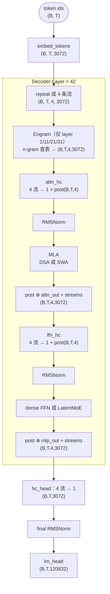

# HY4-Flash 架构与形状

> **config**: `llm/hy4_flash/config.json`（`tencent/Hy4-flash`，transformers 5.23.0）
> **代码**: HuggingFace transformers PR
> [#50903](https://github.com/huggingface/transformers/pull/50903) 的
> [`modeling_hy_v4_flash.py`](https://github.com/huggingface/transformers/blob/b865850d05326cf20e306b31f14b0027de802da3/src/transformers/models/hy_v4_flash/modeling_hy_v4_flash.py)
> **权重**: 没下载。本文所有数字只由 `config.json` 推出，
> 复算脚本是 `accounting.py`，原始输出在 `runs/accounting.log`。

HY4-Flash 不是"更大的 GPT"：它把 42 层 decoder 里的 attention、FFN、残差
三处都换了。先把一句话版本记住：

```
42 层 = 1 层 dense + 41 层 LatentMoE
attention = 12 层 DSA（全局稀疏）+ 30 层 SWA（512 窗口），1:3 交替
残差 = 4 条 iHC 流，不是 1 条
额外 = 4 层 Engram n-gram 记忆 + SigLIP2 ViT + DFly2 投机 drafter
```

总参数 **220.25B**，每 token 只激活 **11.27B**；其中 63.36B 是 Engram 查表，
不参与矩阵乘。这三个数决定了后面所有账。

## 1. 记号

| 符号 | 值 | 含义 |
| --- | ---: | --- |
| `B` | 1 | batch size |
| `T` | 可变 | prefill 的 token 数 |
| `C` | 可变 | decode 时可见的上下文长度（含当前 token） |
| `H` | 3072 | 主干宽度 `hidden_size` |
| `L` | 42 | 主干层数 |
| `h` | 32 | DSA 层的 Q 头数 |
| `h_sw` | 64 | SWA 层的 Q 头数（比 DSA 宽一倍） |
| `D_nope` | 192 | Q/K 的非 RoPE 部分 |
| `D_rope` | 64 | Q/K 的 RoPE 部分 |
| `D_qk` | 256 | `D_nope + D_rope` |
| `D_v` | 256 | V 的头维度 |
| `q_lora` | 1024 | Q 的压缩秩 |
| `kv_lora` | 512 | KV 的压缩秩 |
| `E` | 512 | routed experts 数 |
| `k` | 16 | 每 token 激活的 routed experts |
| `I_moe` | 1536 | 每个 expert 的中间宽度 |
| `D_lat` | 1536 | LatentMoE 的 latent 宽度 |
| `I` | 13824 | layer 0 dense FFN 的中间宽度 |
| `G` | `C / 4` | DSA indexer 的压缩组数 |
| `hc` | 4 | iHC 的 residual stream 条数 |
| `V` | 120832 | 词表大小 |

几个容易看错的 config 字段：

- `head_dim = 64` **不是** Q/K 的宽度，只是 RoPE 切片；Q/K 宽度是
  `qk_nope_head_dim + qk_rope_head_dim = 192 + 64 = 256`。
- `num_key_value_heads = 32` 在 MLA 里没有 GQA 含义；代码里被强制改成
  `num_attention_heads`，K/V 由 `kv_lora_rank=512` 的 latent 展开。
- SWA 层的头数、QK/V 宽度不在 `text_config` 顶层，而在
  `swa_num_attention_heads=64`、`swa_qk_*`、`swa_v_head_dim` 里。
- `layer_types` 里写的是旧名字 `deepseek_sparse_attention`，HF 代码会重映射成
  `indexed_attention`；本文统一叫 DSA / sparse。
- `compressed_indexer_compress_ratio=4` 就是代码里的 `index_kpool`。
- `engram_layer_ids=[2,12,22,32]` 是 **1-based**；对应代码里的
  `layer_idx = 1,11,21,31`。

## 2. 总图



注意 `ADD1` / `ADD2` 的乘法方向：`post` 是 `(B,T,4)`，`attn_out` 是
`(B,T,3072)`，广播成 `(B,T,4,3072)`，再和 4 条 residual 逐条相加。不是把
4 条流先加起来再乘一个标量。

## 3. 一层的数据流

### 3.1 iHC：4 条 residual stream

入口只有一条 `(B,T,3072)`，进第一层前被复制成 4 条：

```
hidden_states = embeds.unsqueeze(2).expand(-1, -1, 4, -1)
              → (B, T, 4, 3072)
```

每个子层（attention / FFN）前，`attn_hc` / `ffn_hc` 做两件事：

```
flat   = streams.flatten(2)                       (B,T,4*3072=12288)
mixes  = (flat @ fnᵀ) * rsqrt(mean(flat²)+eps)   (B,T,8)
pre_b, post_b = base.split(4)                     (4), (4)
pre_logits, post_logits = mixes.split(4)          (B,T,4), (B,T,4)
pre    = sigmoid(pre_logits * pre_scale + pre_b) + eps
post   = 2.0 * sigmoid(post_logits * post_scale + post_b) + eps
x      = Σ_i pre[...,i] * streams[...,i,:]        (B,T,3072)
```

`fn` 的形状是 `(2*hc, hc*H) = (8, 12288)`，一层两条 HC，共 196,628 个参数。
子层算完后：

```
streams = post[...,None] * sublayer_out[:, :, None, :] + streams
        → (B,T,4,3072)
```

这就是 "identity Hyper-Connection"：子层输出只加到 4 条流上，不替换它们；
`post` 是每条流自己的门。最后一层之后 `hc_head` 再把 4 条流压成 1 条：

```
flat   = streams.flatten(2)                       (B,T,12288)
mixes  = (flat @ hc_fnᵀ) * rsqrt(mean(flat²)+eps) (B,T,4)
pre    = sigmoid(mixes * hc_scale + hc_base) + eps
out    = Σ_i pre[...,i] * streams[...,i,:]        (B,T,3072)
```

### 3.2 MLA：把 K/V 压成 576 维 latent

在投影形状上，DSA 和 SWA 的差别只有头数（32 vs 64），完全同构；
此外 SWA 的 RoPE theta 是 1e4、DSA 是 1e7，且 SWA 没有 indexer。

| 步骤 | DSA（h=32） | SWA（h_sw=64） | 公式 |
| --- | --- | --- | --- |
| 输入 `x` | `(B,T,3072)` | `(B,T,3072)` | |
| `q_resid` | `(B,T,1024)` | `(B,T,1024)` | `q_a_norm(x @ Wq_aᵀ)` |
| `q` | `(B,T,32,256)` | `(B,T,64,256)` | `q_resid @ Wq_bᵀ` |
| `q_nope` | `(B,T,32,192)` | `(B,T,64,192)` | 前 192 维 |
| `q_rope` | `(B,T,32,64)` | `(B,T,64,64)` | 后 64 维，过 MRoPE |
| `kv` | `(B,T,576)` | `(B,T,576)` | `x @ Wkv_aᵀ` |
| `k_pass` | `(B,T,512)` | `(B,T,512)` | 前 512 维，`kv_a_norm` |
| `k_rope` | `(B,T,1,64)` | `(B,T,1,64)` | 后 64 维，过 MRoPE |
| `kv_b` | `(B,T,32,448)` | `(B,T,64,448)` | `k_pass @ Wkv_bᵀ` |
| `k_nope` / `v` | `(B,T,32,192)` / `(B,T,32,256)` | `(B,T,64,192)` / `(B,T,64,256)` | 按 192/256 切 |
| `k` | `(B,T,32,256)` | `(B,T,64,256)` | `concat(k_nope, k_rope)` |
| `scores` | `(B,32,T,K)` | `(B,64,T,K)` | `q @ kᵀ / √256` |
| `probs` | `(B,32,T,K)` | `(B,64,T,K)` | softmax，含 sink |
| `attn` | `(B,32,T,256)` | `(B,64,T,256)` | `probs @ v` |
| `gate` | `(B,T,32,256)` | `(B,T,64,256)` | `sigmoid(x @ Wgateᵀ)` |
| `attn_out` | `(B,T,3072)` | `(B,T,3072)` | `(attn * gate).reshape @ Woᵀ` |
| `out` | `(B,T,3072)` | `(B,T,3072)` | `post_proj_norm(attn_out)` |

`K` 的取值：

| 层型 | `K` | 说明 |
| --- | ---: | --- |
| DSA / sparse | `min(C, 2048)` | indexer 选出的 512 组 × 4 token |
| SWA / sliding | `min(C, 512)` | 511 个前文 + 自己 |
| DSA，`C <= 2048` | `C` | indexer 整段跳过，退化成 dense |

三个容易漏的细节：

1. **sink**：每个头有一个可学习标量 `sinks[h]`，softmax 前拼在 logits 最后
   一列，算完 softmax 再丢掉。形状上等价于分母多一个 `exp(sink)`，不是
   attention 输出的一部分。
2. **gate**：`gate_proj` 是 `H → h*D_v`，和 V 同宽；`attn` 先逐元素乘
   `sigmoid(gate)`，再拼头、过 `o_proj`。
3. **post_proj_norm**：`o_proj` 之后还有一个 RMSNorm，属于 sandwich norm
   的后半；不要把它和 FFN 前的 `post_attention_layernorm` 弄混。

### 3.3 DSA：先选 2048 个 token，再做 attention

DSA 层多一个压缩 indexer，输入是 **`q_resid`（1024 维）**，不是 `q`：

```
token_keys = token_key_norm(x @ W_token_keyᵀ)          (B,T,128)
group_keys = pool_4(token_keys)                        (B,T/4,128)
q_idx      = q_resid @ W_queryᵀ                        (B,T,16,128)
scores     = relu(q_idx @ group_keysᵀ)                 (B,T,16,T/4)
head_w     = head_weight_projection(x)                 (B,T,16)
logits     = head_w @ scores                           (B,T,T/4)
mask       = 当前组及未来组置 -inf（自己的组随后无条件加回）
recalled   = top-(512-1) 组 + 自己所在组               (B,T,512)
           → 展开成 512*4 = 2048 个 token 的布尔 mask
attention_mask = attention_mask.masked_fill(unrecalled, -inf)
```

`pool_4` 不是平均池化：4 个 token 的 key 先各过两个 fp32 的
`128×128` Linear（`key_value_projection`、`key_gate_projection`），加
`intra_group_ape`，在 4 个槽上 softmax 后加权求和，再过 `key_norm`。
所以 "压缩组" 是一个学出来的 4 槽 softmax 软池化，不是 `mean`。

当 `C <= index_topk(2048)` 时，`forward` 直接返回原 mask，不做池化、不做
top-k；短 prompt 没有额外开销。超过之后，每个 query 要跟 `C/4` 个组打分，
这是 DSA 在长上下文下的主要额外计算。

### 3.4 SWA：512 token 的因果窗口

SWA 层没有 indexer，attention mask 是：

```
mask[i, j] = j <= i and j >= i - 511
```

`K = min(C, 512)`。因为窗口固定，KV cache 可以做成 512 的环形缓冲区；
但 HF 的 `DynamicCache` 默认仍是全历史，是否省内存取决于推理框架。

### 3.5 LatentMoE：expert 在 1536 维里算

41 个 MoE 层的形状：

```
x                       (B,T,3072)
router_logits = x @ Wrᵀ (B,T,512) → sigmoid → + bias
top-16 experts，权重归一化后 × 3.998
routed_in = pre_expert_proj(x)          (B,T,1536)
for each of 16 experts:
    gate_up = routed_in @ W_eᵀ          (B,T,3072)
    h = silu(clamp(gate, max=10)) * clamp(up, ±10)   (B,T,1536)
    out_e = h @ W_dᵀ                    (B,T,1536)
routed_out = Σ weight_e * out_e         (B,T,1536)
routed_out = post_expert_proj(routed_out) (B,T,3072)
shared     = MLP_1536(x)                (B,T,3072)
out        = combine_output_norm(routed_out + shared)  (B,T,3072)
```

关键点：**routed experts 的输入/输出是 1536 维，不是 3072 维**。
`pre_expert_proj` / `post_expert_proj` 把主干和 latent 接起来；router 和
shared expert 仍然看 3072 维的 `x`。每个 expert 的参数是
`2*1536*1536 + 1536*1536 = 7,077,888`，512 个就是 3.624B；41 层共 148.6B，
这就是 155.5B 主干里最大的一块。

Layer 0 不是 MoE，是普通 SwiGLU：`3072 → 13824 → 3072`，三个矩阵共
127.4M 参数。

### 3.6 Engram：4 层的 n-gram 查表

Engram 在 layer 1/11/21/31（0-based）的 attention **之前**执行，输入是
`ngram_tokens`（每个位置当前 token + 前 2 个 token）：

```
ngram_tokens  (B,T,3) = [t, t-1, t-2]，越界用 pad_id
hash_ids      (B,T,16) = 2 个 order（2-gram/3-gram）× 8 个哈希头
emb           (B,T,16,96) → 每个头 RMSNorm → flatten (B,T,1536)
value         = value_proj(emb)                       (B,T,3072)
for hc_index in 0..3:
    key   = norm_key[key_proj(emb)]                   (B,T,3072)
    query = norm_query[streams[:,:,hc_index]]         (B,T,3072)
    gate  = sigmoid(sqrt(|key·query|/√3072|) * sign)  (B,T)
out = gate * (pre_gamma * rmsnorm(value)) + per_hc_scales(value)
    → (B,T,4,3072)
```

每个哈希头有一张独立的素数模表：8 个头 × 2 个 order = 16 张/层，每张约
10.3M 行，每行 96 维。4 层共 **63.36B** 参数，bf16 约 126.7GB。查表只读
命中的 16 行，不读整张表；但表必须常驻（或放在 CPU / NVMe 上按行取）。

视觉 span 和 padding 位置没有 token id，`engram_mask` 会把它们置零；所以
Engram 只在纯文本 token 上生效。

### 3.7 42 层怎么排

```
layer 0        : DSA  + dense FFN(13824)        + iHC
layer 1        : DSA  + MoE                     + iHC + Engram
layer 2-4      : SWA  + MoE                     + iHC
layer 5        : DSA  + MoE                     + iHC
layer 6-8      : SWA  + MoE                     + iHC
layer 9        : DSA  + MoE                     + iHC
layer 10-12    : SWA  + MoE                     + iHC   ← Engram 在 11
layer 13       : DSA  + MoE                     + iHC
...
layer 41       : DSA  + MoE                     + iHC
```

精确模式：`2 × DSA` 开头，然后 `10 × (3 × SWA + 1 × DSA)`：

```
DSA DSA [SWA SWA SWA DSA] × 10
= 2 + 10 = 12 层 DSA
= 10 × 3 = 30 层 SWA
```

`engram_layer_ids` 的 1-based `[2,12,22,32]` → 0-based `1,11,21,31`；
其中 1 和 21 是 DSA 层，11 和 31 是 SWA 层。DFly2 的 5 个 draft 层挂在
`25,29,33,37,41`（都是 DSA 层）上，复用这些层的 KV 和 indexer 选择结果。

## 4. 参数账

### 4.1 Attention：一层

| 组件 | DSA（h=32） | SWA（h_sw=64） | 公式 |
| --- | ---: | ---: | --- |
| `q_a_proj` | 3,145,728 | 3,145,728 | `H*q_lora` |
| `q_a_layernorm` | 1,024 | 1,024 | `q_lora` |
| `q_b_proj` | 8,388,608 | 16,777,216 | `q_lora*h*D_qk` |
| `kv_a_proj_with_mqa` | 1,769,472 | 1,769,472 | `H*(kv_lora+D_rope)` |
| `kv_a_layernorm` | 512 | 512 | `kv_lora` |
| `kv_b_proj` | 7,340,032 | 14,680,064 | `kv_lora*h*(D_nope+D_v)` |
| `gate_proj` | 25,165,824 | 50,331,648 | `H*h*D_v` |
| `o_proj` | 25,165,824 | 50,331,648 | `h*D_v*H` |
| `post_proj_norm` | 3,072 | 3,072 | `H` |
| `sinks` | 32 | 64 | `h` |
| **MLA core** | **70,980,128** | **137,040,448** | |
| `compressed_indexer` | 2,573,056 | 0 | 仅 DSA |
| **一层合计** | **73,553,184** | **137,040,448** | |

Indexer 的 2,573,056 拆开：

| 组件 | 参数 |
| --- | ---: |
| `query_projection` | 2,097,152 |
| `head_weight_projection` | 49,152 |
| `token_key_projection` | 393,216 |
| `token_key_norm` | 128 |
| `key_value_projection` | 16,384 |
| `key_gate_projection` | 16,384 |
| `key_norm` | 128 |
| `intra_group_ape` | 512 |
| **合计** | **2,573,056** |

42 层合计：

```
12 × 73,553,184  =   882,638,208
30 × 137,040,448 = 4,111,213,440
                     ─────────────
                     4,993,851,648
```

### 4.2 LatentMoE：一层

| 组件 | 参数 | 公式 |
| --- | ---: | --- |
| routed experts | 3,623,878,656 | `512 × 7,077,888` |
| shared expert | 14,155,776 | `3*H*I_moe` |
| `pre_expert_proj` | 4,718,592 | `H*D_lat` |
| `post_expert_proj` | 4,718,592 | `D_lat*H` |
| router gate | 1,572,864 | `E*H` |
| `combine_output_norm` | 3,072 | `H` |
| **一层合计** | **3,649,047,552** | |
| 41 层合计 | 149,610,949,632 | |

每个 expert：

```
gate_up_proj  (2*1536, 1536) = 4,718,592
down_proj     (1536, 1536)   = 2,359,296
                              ─────────
                              7,077,888
```

每 token 只激活 top-16：

```
16 × 7,077,888 = 113,246,208
+ shared        14,155,776
+ pre/post       9,437,184
+ router         1,572,864
+ norm               3,072
                 ─────────
                 138,415,104 / 层
```

### 4.3 Engram：4 层

| layer（1-based） | 表行数 | 表参数（96 维/行） |
| ---: | ---: | ---: |
| 2 | 164,994,380 | 15,839,460,480 |
| 12 | 164,999,008 | 15,839,904,768 |
| 22 | 165,004,086 | 15,840,392,256 |
| 32 | 165,008,942 | 15,840,858,432 |
| **合计** | | **63,360,615,936** |

每层另有 23,649,792 个投影 / norm 参数：

```
16 × 96                        1,536     每头 RMSNorm
(2*768)*3072 + 3072            4,721,664 value_proj + bias
4 × ((2*768)*3072 + 3072)     18,886,656 key_projs + bias
4*3072 + 4*3072               24,576      norm_key / norm_query
3072                           3,072      unified_pre_gamma
4*3072                        12,288      per-hc scales
                              ─────────
                              23,649,792
```

4 层投影合计 94,599,168；Engram 总计 **63,455,215,104**。

### 4.4 ViT：SigLIP2-So400m 形状

| 部分 | 参数 |
| --- | ---: |
| patch embedding（3×16×16 → 1152） | 885,888 |
| position embedding（128×128 + cls） | 18,875,520 |
| 27 × block | 411,466,608 |
| **视觉塔合计** | **431,228,016** |
| patch merger / projector | 35,401,344 |
| **ViT 总计** | **466,629,360** |

每个 block 15,239,504：

```
2 × LayerNorm                 4,608
q/k/v/o (1152→1152, bias)  5,313,024
fc1 + fc2 (1152↔4304)      9,921,872
                           ─────────
                          15,239,504
```

官方卡片写 "ViT 0.43B"，对应的是**视觉塔** 431.2M；patch merger 的 35.4M
没有算进 0.43B。本文两个都列。

### 4.5 总账与对账

| 部分 | 参数量 |
| --- | ---: |
| 文本主干（不含 Engram） | 155,483,166,797 |
| Engram（表 + 投影） | 63,455,215,104 |
| ViT（塔 + merger） | 466,629,360 |
| DFly2 drafter | 846,190,697 |
| **总计** | **220,251,201,958** |

对账：

| 项 | 本文 | 官方 | 差 |
| --- | ---: | ---: | ---: |
| 文本主干 | 155,483,166,797 | 155.5B | −0.011% |
| Engram | 63,455,215,104 | 63.5B | −0.071% |
| ViT 塔 | 431,228,016 | 0.43B | +0.286% |
| DFly2 | 846,190,697 | 0.85B（卡片） | −0.448% |
| 总参数 | 220,251,201,958 | 220,251,201,958（HF safetensors） | **0** |
| 文本激活 / token | 11,270,639,693 | 11.3B | −0.26% |

DFly2 的 846,190,697 不是从 config 算出来的（config 只给了
`dfly_num_hidden_layers=5` 和目标层号），而是用 HF safetensors 总数减去
其余三项反推的。它和官方卡片 "0.85B" 差 3.55M（−0.42%，官方四舍五入）；
反过来，用这个反推值加上其余三项，总数和 HF safetensors 逐位相等。

## 5. 计算量

### 5.1 线性层
> 单位：`G = 10⁹`、`T = 10¹²`（和厂商标的 TFLOPs 一致）。手算时凑 1024 记 K 只是为了快，不影响这里的读法。


一个 Linear `(m,k) @ (k,n)` 是 `m*k*n` 次乘加，算 2 FLOPs：

```
FLOPs = 2 × token 数 × in × out
```

手算一个算子（`lm_head`，每 token）：

```
m = 1, k = 3072, n = 120832
1 × 3072 × 120832 = 371.2M 次乘加
× 2 = 0.74G FLOPs
```

把所有 Linear 按 `m×k×n` 逐项累加，结果等于"激活参数 × 2"：

```
2 × 11,270,639,693 = 22.541 G FLOPs/token
```

这个等式成立，是因为每个激活权重对每个 token 只用一次。**别把它当定义**——
推导仍然是 `m×k×n`。

这已经包含 attention 的 q/kv/o/gate、indexer 的投影、MoE 的 top-16
experts + shared + pre/post、router、lm_head、Engram 投影；不包含
embedding 查表（不是矩阵乘）。

### 5.2 Attention core

QK^T 和 attn@V 不包含在"激活参数×2"里，要单独加：

```
QK   = 2 × h × Σ_i min(i, K) × D_qk
AV   = 2 × h × Σ_i min(i, K) × D_v
```

decode（`T=1`，上下文 `C`）：

```
QK + AV = 2 × h × min(C, K) × (D_qk + D_v)
```

`K` 按层型取 2048 / 512。长上下文下每 token 的 core 饱和在：

```
DSA: 12 × 2 × 32 × 2048 × 512 = 805.3M
SWA: 30 × 2 × 64 ×  512 × 512 = 1,006.6M
                              ─────────
                              1.812 G FLOPs/token
```

### 5.3 DSA indexer

indexer 的打分是 `16 头 × 128 维`，每个 query 对 `C/4` 个组：

```
score = 12 × [2 × 16 × 128 × (C/4)]  ≈ 12,288 × C
head  = 12 × [2 × 16 × (C/4)]        ≈     96 × C
                                      ─────────────
total ≈ 12,384 × C FLOPs/token
```

- `C <= 2048`：0（整段跳过）。
- `C = 128K`：1.62G / token。
- `C = 1M`：12.99G / token。

prefill 时 HF eager 会对**全部** `T × T/4` 个 query-group 对打分（future
先算再 mask），所以是 `O(T²)`；按 causal 只算一半是下界。1M prefill 时
eager 是 13.62P，causal 下界 6.81P。

另外，`pool_groups` 在 eager decode 里每个 step 会对**所有**组重算两个
128×128 Linear：

```
12 × (C/4) × 4 × 4 × 128²
```

1M 上下文时约 **824.6G FLOPs/token**，比 22.5G 的权重乘加还大。优化的
kernel 会缓存 pooled keys，只更新最后一个未满的组；这部分在账本里单列，
不计入 "理想" 的 decode 总量。

### 5.4 四个上下文长度

| `T` / `C` | prefill 总 FLOPs | prefill / token | decode / token（理想） | decode / token（eager 池化） |
| ---: | ---: | ---: | ---: | ---: |
| 1K | 24.062 T | 23.498 G | 23.951 G | 23.951 G |
| 8K | 199.258 T | 24.323 G | 24.455 G | 30.897 G |
| 128K | 3,403.802 T | 25.969 G | 25.976 G | 129.056 G |
| 1M | 39,152.296 T (39.152 P) | 37.339 G | 37.339 G | 861.973 G |

1M 的 decode 拆开：

```
线性层                 22.541 G   (60.4%)
attention core          1.812 G   ( 4.9%)
indexer 打分           12.986 G   (34.8%)
                       ─────────
理想合计               37.339 G FLOPs/token
eager 池化            824.634 G
                       ─────────
eager 合计            861.973 G FLOPs/token
```

短上下文 decode 约 24G FLOPs/token，和 `2 × 11.27B` 对得上；长上下文的
增量几乎全部来自 indexer 的 `O(C)` 选择，而不是 attention 本身。

## 6. 访存

### 6.1 权重

| 项 | Bytes |
| --- | ---: |
| checkpoint 常驻（BF16） | 440.51 GB / 410.26 GiB |
| 其中 Engram 表 | 126.72 GB |
| 其中 ViT | 0.93 GB |
| 运行时 lm_head 转 fp32 额外 | 0.74 GB |
| decode 读权重（top-16，含 fp32 lm_head） | 23.28 GB / 21.68 GiB |
| prefill 读权重（4K，全专家命中） | 312.86 GB |
| prefill 读权重（1M，含 Engram 行） | 319.27 GB |

prefill 不需要把 63.36B 的 Engram 表整张读一遍：每 token 只查
`4 层 × 16 头 × 96 维`，约 12KB；但表必须能放下，或者按行从 CPU / NVMe
取。decode 同理。

### 6.2 KV cache

MLA 每层只存 `kv_lora(512) + k_rope(64) = 576` 维，不存展开后的
`h × 256` 的 K/V。DSA 层再存一份 indexer 的 token key（128 维）：

```
全历史 / token = 42 × 576 × 2B + 12 × 128 × 2B
               = 48,384 + 3,072
               = 51,456 B = 50.25 KiB
```

HF 默认：`DynamicCache(config=...)` 会把 `sliding_attention` 层建成
`DynamicSlidingWindowLayer`，所以 30 个 SWA 层只保留 512 token，只有 12 个
DSA 层存全历史：

```
12 × (576 + 128) × 2B = 16,896 B = 16.50 KiB / token
+ 30 × 576 × 511 × 2B = 17.66 MB（固定环形窗口；attention 窗口仍是 512）
```

| 上下文 | 全历史（上界） | HF 默认（SWA 环形） |
| ---: | ---: | ---: |
| 1K | 50.25 MiB | 16.50 MiB + 16.9 MiB |
| 8K | 402.0 MiB | 132.0 MiB + 16.9 MiB |
| 128K | 6.29 GiB | 2.06 GiB + 16.9 MiB |
| 1M | 50.25 GiB | 16.52 GiB |

> 注意：左列是 42 层都按全量 cache 存的上界；右列才是 HF
> `DynamicCache(config=...)` 的默认行为。vLLM 的 `FLASHMLA_SPARSE` 后端也
> 按 SWA 窗口处理。

### 6.3 算术强度

decode 一个 token 的访存 = 激活权重 23.28GB（含 fp32 lm_head）+ KV：

| 上下文 | FLOPs/token（理想） | Bytes/token（HF 默认） | AI（FLOP/B） |
| ---: | ---: | ---: | ---: |
| 1K | 23.951 G | 23.28 GB + 0.03 GB | ≈1.03 |
| 128K | 25.976 G | 23.28 GB + 2.23 GB | 1.02 |
| 1M | 37.339 G | 23.28 GB + 17.73 GB | 0.91 |

若按 42 层全历史 KV 上界，1M 的 Bytes/token 是 23.28 + 53.96 = 77.24GB，
AI 降到 0.48。BF16 权重下 "2 FLOPs / 2B = 1 FLOP/B" 是短上下文的基线；
长上下文 KV 变大，AI 反而更低。即使算上 eager 池化的 862G FLOPs，1M 的
AI 也只有 21.0 FLOP/B（HF 默认）或 11.16（全历史上界），远低于 B200 的
281 FLOP/B —— **decode 始终是访存瓶颈**。

prefill 相反：1M 时 39.15P FLOPs / (319.27GB 权重 + 17.73GB KV 写入)
≈ 116,000 FLOP/B，是 compute-bound；按全历史上界（+53.96GB）约 105,000。

## 7. 这张账没算什么

1. **DFly2 的 FLOPs**。它是 5 层 drafter，复用目标模型的 KV 和 indexer
   选择；config 只给了层数和目标层号，没给 drafter 的宽度/专家数，所以
   只把它 0.846B 的参数算进总参数，计算量没算。
2. **ViT 的 FLOPs**。上面的 FLOPs 表是纯文本 token；有图时还要加视觉塔
   的 27 层 forward 和 patch merger。
3. **训练**。只算推理前向，不含反向、优化器状态、激活 checkpoint。
4. **norm / softmax / RoPE / 量化 / 通信**。这些是零头，但在 decode 的
   微观 profile 里会变成 kernel launch 和带宽的零头。
5. **eager indexer 池化**。`pool_groups` 每个 decode step 重算所有组，
   是 HF 参考实现的行为；生产 kernel 应缓存 pooled keys。账本里给了
   "理想" 和 "eager" 两列，不要混用。
6. **prefill 的 causal 下界**。HF eager 的 indexer 打分是完整 `T×T/4`；
   如果 kernel 利用 causal mask，计算量约减半。

## 8. 一句话总结

HY4-Flash 的 155.5B 主干里，148.6B 是 41 层 ×512 个 LatentMoE expert；
真正每 token 动的只有 11.27B。decode 的 23.3GB 权重访存决定了它短上下文
的速度下限；1M 上下文时 50.25GiB 的 KV（或 16.52GiB 的 SWA 环形窗口）
和 indexer 的 `O(C)` 选择决定长上下文的速度。参数量对账到 HF safetensors
的 220,251,201,958，误差为 0。
