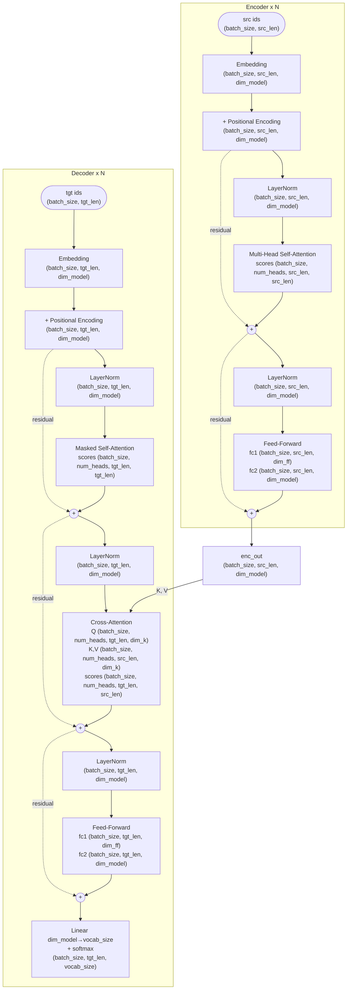
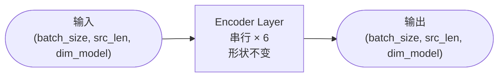
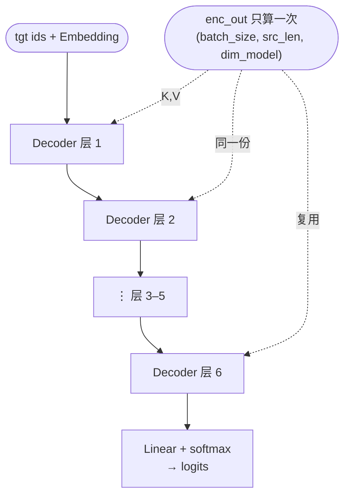

# Transformer 架构图

## 1. 任务

《Attention Is All You Need》（Vaswani 等，Google，2017）做的是**机器翻译**：
一句英文进去，一句德文出来。

论文在 WMT 2014 上验证了两个方向：

| 方向 | BLEU |
| --- | --- |
| 英 → 德 | 28.4 |
| 英 → 法 | 41.8 |

（另外还试了英文句法分析，用来说明能泛化到翻译之外。）

一句话进去、一句话出来，**两边长度通常不一样**：

```
输入（英）  "A long time ago"   →  ['A', ' long', ' time', ' ago']        4 个 token
输出（德）  "Vor langer Zeit"   →  ['V', 'or', ' l', 'anger', ' Zeit']   5 个 token
```

token 不是按空格分的。每个 tokenizer 有自己的一张词表，切法完全不同：

- **`" long"` 带前导空格，整体是一个 token**（id 890）。空格被一起打包进去了：
  同一个词 `"long"` 不带空格是另一个 token（id 6511）
- **`"Vor"` 被切成 `"V" + "or"`** —— 德语词在英文词表里罕见，没有整片，只能切碎
- 同样一句 `"Vor langer Zeit"`，换 o200k tokenizer 就变成 `['Vor', ' langer', ' Zeit']`，3 个

所以"几个 token"不是文本的属性，是 tokenizer 的属性。上面这组数字用 GPT-2 的
tokenizer 切出来的；论文当年用的是在 WMT 上训的 BPE（词表约 37000），切法不同。

回到长度：输入那条记作 `src_len`，要生成那条记作 `tgt_len`，两者通常不等。
两个长度同时出现在模型里，cross-attention 就是为了把它们对上。

训练时目标句已知，整句喂进 decoder（右移一位，叫 teacher forcing）；
推理时未知，decoder 一个 token 一个 token 往后接。

## 2. 记号

| 名字 | 全称 | 是什么 |
| --- | --- | --- |
| `batch_size` | batch size | 一次并行算几条句子 |
| `seq_len` | sequence length | 一条句子切成几个 token |
| `src_len` | source sequence length | 输入句的 token 数 |
| `tgt_len` | target sequence length | 输出句的 token 数 |
| `dim_model` | model dimension | 每个 token 表示成多少维向量 |
| `num_heads` | number of attention heads | 把 `dim_model` 切成几组 |
| `dim_k` | key dimension | 每组多少维，`dim_k = dim_model / num_heads` |
| `dim_ff` | feed-forward dimension | FFN 中间宽度，惯例 `4 * dim_model` |
| `vocab_size` | vocabulary size | 词表里有多少个不同的 token |
| `num_layers` | number of layers | 这一摞堆几层 |

和 `config.json` 的对应（装真实模型时按这个找字段）：

| 本文 | `config.json` |
| --- | --- |
| `dim_model` | `hidden_size` |
| `num_heads` | `num_attention_heads` |
| `dim_k` | `head_dim`（通常不给，等于 `hidden_size / num_attention_heads`） |
| `dim_ff` | `intermediate_size` |
| `vocab_size` | `vocab_size` |
| `num_layers` | `num_hidden_layers` |

两条不变式：

```
dim_model = num_heads * dim_k        dim_model=512, num_heads=8  →  dim_k=64
每层进出都是 (batch_size, seq_len, dim_model)    seq_len 泛指 src_len 或 tgt_len
```

`dim_k` 是**每个头内部**的维度。512 维被平均切成 8 份，每份 64 维，
8 个头各算各的注意力，最后拼回 512：

```
x            (batch_size, seq_len, 512)
Q/K/V 投影    (batch_size, seq_len, 512)
拆头          (batch_size, 8, seq_len, 64)     ← 8 × 64 = 512
拼头          (batch_size, seq_len, 512)
```

### 2.1 一组真实数字

```
句子          "A long time ago"
切成 token     4 个                  src_len = 4
加 batch 维    (1, 4)                batch_size = 1
Embedding      (1, 4, 512)           dim_model = 512
```

Embedding 只回答"这个词是什么"——把 id 换成 `dim_model` 维空间里的一个点，
这个点有没有语义，取决于训练。它**不回答"这个词在第几位"**：顺序信息由下一行的
`+ Positional Encoding` 补上，两者形状相同，直接相加。

论文 base 模型：`dim_model = 512`、`num_heads = 8`、`dim_k = 64`、`dim_ff = 2048`，
encoder 和 decoder 各 6 层（`num_layers = 6`）。两个 N 互相独立，可以设成不一样。
`(1, 4)` 里的 4 不是常数，句子多长就是多少。

## 3. 结构

### 3.1 怎么读图

| 记号 | 含义 |
| --- | --- |
| 箭头 | 数据流方向，和代码同向（从上往下） |
| 方框第二行 | 该步的关键张量形状：Attention 标 Q/K/V/scores，FFN 标中间宽度 `dim_ff`，其余是输出形状 |
| 虚线 | 残差：从**子层的输入**分叉，绕过子层，和子层输出在 `(+)` 相加；每个子层各有一条 |
| `(+)` 圆圈 | 逐元素相加，不是矩阵乘 |
| `LayerNorm` | 每个 token 独立，在最后一维 `dim_model` 上归一化，形状不变 |
| `× N` | 这一摞重复 `N` 次。每层结构相同、**权重各自独立**；形状不变，所以能无限堆 |

### 3.2 三个入口/出口的事实

1. **有两个入口，并列**：`src ids` 进 encoder，`tgt ids` 进 decoder（圆角框是输入）。
   `tgt ids` 不是 `enc_out` 变来的，两者互相独立；encoder 画在图上边只是排版。
2. **encoder 只在 `enc_out` 处跟外界发生关系**，它没有向上的出口。
3. `enc_out` 在 decoder 里**只当 K 和 V**，不当 Q。Q 来自 decoder 自己 ——
   所以 cross-attention 是全图**唯一**两个长度相遇的地方：
   `scores` 是 `(batch_size, num_heads, tgt_len, src_len)`。
   其他所有张量的序列维只有一个长度：encoder 侧是 `src_len`，decoder 侧是 `tgt_len`。

### 3.3 图 1 · 全貌



虚线从哪来：它没有独立来源，残差就是**这个子层自己的输入**。encoder 第一个子层里 `P` 分两路：一路进 `LN → Attention`，一路原样绕过，在 `(+)` 与 `A1` 相加得到 `R1`；第二个子层同理，`R1` 绕过 FFN，与 `F1` 相加得到 `R2`。decoder 的每个子层也一样。所以 6 层堆叠时每层自带两条残差，第 n 层的输入就是第 n−1 层的输出。

### 3.4 causal mask

图 1 里 decoder 的 `Masked Self-Attention` = 普通 self-attention + 一张 mask：
**遮住右上角**（行是"正在算的 token"，列是"被看的 token"）。
mask 加在 `scores` 上，形状 `(batch_size, num_heads, tgt_len, tgt_len)`。

下面表里 `ok` 表示可见，`-inf` 表示遮住（未来的位置）。

`tgt_len = 4`，`-inf` 必须在 softmax **之前**加：

|  | k0 | k1 | k2 | k3 | softmax 后 |
| --- | --- | --- | --- | --- | --- |
| **q0** | ok | -inf | -inf | -inf | `[1, 0, 0, 0]` |
| **q1** | ok | ok | -inf | -inf | `[.5, .5, 0, 0]` |
| **q2** | ok | ok | ok | -inf | `[.33, .33, .33, 0]` |
| **q3** | ok | ok | ok | ok | `[.25, .25, .25, .25]` |

softmax 之后再乘 0 会让每行和小于 1，等于让模型丢了一部分注意力预算。

### 3.5 推理时怎么生成

训练时目标句是完整的，一次前向就算完。**推理时没有目标句**，只能一个一个往外蹦：

```
step 0:  输入 [起始符]                  tgt_len=1  → 输出 "8"
step 1:  输入 [起始符, 8]               tgt_len=2  → 输出 "很久以前"
step 2:  输入 [起始符, 8, 很久以前]      tgt_len=3  → 输出 EOS，停
```

每一步做四件事：

1. 把当前序列**整串**喂进 decoder（6 层全部跑一遍）
2. 只取**最后一个位置**的 logits，前面位置的丢掉
3. `argmax` 得到下一个 token
4. 拼到序列末尾，回到第 1 步

这就是**自回归**：上一步的输出，就是这一步的输入。

```
输出 "8"  →  拼到输入末尾  →  再跑一遍  →  输出 "很久以前"  →  ...
```

三个直接后果：

- **`tgt_len` 每步 +1**：1 → 2 → 3
- **causal mask 跟着变大**：1×1 → 2×2 → 3×3
- **前面算过的位置又算了一遍**：第 2 步重算了第 1 步的结果，完全一样，纯浪费

真实推理用 **KV cache** 避免这个浪费：每步只算新 token 的 Q（`q_len = 1`），
K/V 从缓存里读（`kv_len` 一直涨）。`model.py` 为了看清形状没有用 cache，
所以日志里 `q_len` 和 `kv_len` 一起涨。

停止条件：遇到 EOS，或达到 `max_new_tokens`。

### 3.6 6 层是怎么堆的

**图 2 · Encoder**：同一个 block 串行 6 次，每层权重独立，形状全程不变。



**图 3 · Decoder**：同样串行，区别是每一层都额外接**同一份** `enc_out`（虚线）。



两个容易搞错的点：

1. **不是交替**。不是 `enc1 → dec1 → enc2`。是 encoder 6 层全部跑完，decoder 才开始。
2. **`enc_out` 只算一次**。6 个 decoder 层共用同一份，不是每层重算。

> 图里是 **pre-LN**（LayerNorm 在残差分支内）。这篇论文用的是 post-LN：
> `子层 → (+) → LayerNorm`。两者只差 LN 的位置，但 post-LN 需要 warmup。

## 4. 参数与计算量

这一章算三样东西：**参数量、计算量、访存量**。算它们是为了回答同一个问题——耗时。

```
访存耗时 = Bytes ÷ 有效带宽
计算耗时 = FLOPs ÷ (峰值算力 × MFU)
总耗时   ≈ max(访存耗时, 计算耗时)      ← 搬运和计算可以重叠，不是相加
```

- **有效带宽**：标称值的 70~85%，只有大块连续读才接近上限
- **MFU**（Model FLOPs Utilization）：实际算力 ÷ 峰值，大模型训练常在 30~50%，小 batch 推理更低

哪个大，哪个就是瓶颈。判断方法：算算术强度 `FLOPs ÷ Bytes`，
和硬件的 `算力 ÷ 带宽` 比——小于它就卡带宽。

本章的数字用 1024 进制写：`1K = 1024`、`1M = 1024²`、`1G = 1024³`、`1T = 1024⁴`、`1P = 1024⁵`，`≈` 表示四舍五入。
字节也一样：`1K = 1024 B`、`1M = 1024² B`。

**为什么算起来这么整**：模型里的宽度都是 2 的幂——`512 = 2⁹`、`2048 = 2¹¹`。
两个 2 的幂相乘，指数一加，结果必然是整 K、整 M：

```
512 × 512  = 2⁹ × 2⁹  = 2¹⁸ = 256K
512 × 2048 = 2⁹ × 2¹¹ = 2²⁰ = 1M
2048 × 512 = 2¹¹ × 2⁹ = 2²⁰ = 1M
```

**边乘边约**：每凑够 `2¹⁰` 就记成 `1K`，带着 `K` 继续参与运算，不用等算完：

```
2 × 5 × 512 × 512
= 2 × 5 × 256 × (2 × 512)   ← 2 × 512 = 1024 = 1K
= 2 × 5 × 256 × 1K
= 2,560 × 1K
= 2,560K
= 2.5M
```

**bias 为什么可以忽略**：`262,144 + 512`，512 相对 256K 只有 0.2%，进不了位，
所以 `≈256K` 就是精确到 K 的结果。

本文所有形状和参数量都由 `model.py` 实跑得到，原始输出在 `runs/model_py_flow.log`。

前向图里每个方框，除了 reshape、softmax、加法这些没有参数的，其余都带**可学习参数**：矩阵权重、bias，以及 LayerNorm 的 γ/β。这些参数是训练时学出来的。
先数参数，是因为它决定模型大小和 4.3 的权重访存；4.2 的 FLOPs 则直接按 shape 算，不依赖总参数量。
4.1 数参数；4.2 / 4.3 按**推理**的前向算乘加和访存，不包含训练的反向传播和优化器状态。
以 `opus-mt-en-zh` 为例（`dim_model=512`、`dim_ff=2048`、encoder/decoder 各 6 层）：

### 4.1 参数量

参数量 = 所有**可学习**张量的元素个数：

encoder 和 decoder 各一层里：

| 类别 | 张量 | encoder 一层 | decoder 一层 |
| --- | --- | --- | --- |
| 注意力投影 | `q_proj` / `k_proj` / `v_proj` / `out_proj` 的 weight | 4 × (512×512) | 8 × (512×512) |
| | 每个投影的 bias | 4 × 512 | 8 × 512 |
| FFN | `fc1` weight + bias | 2048×512 + 2048 | 同左 |
| | `fc2` weight + bias | 512×2048 + 512 | 同左 |
| LayerNorm | γ + β | 2 组 × 512 | 3 组 × 512 |

decoder 多出来的 4 个投影和 1 组 LayerNorm 都属于 cross-attention。

全模型额外两个：

| 张量 | 形状 | 说明 |
| --- | --- | --- |
| Embedding（= `lm_head`） | 65001×512 | 一个矩阵，两处用 |
| `final_logits_bias` | 1×65001 | 输出偏置 |

不算：

- sin/cos 位置编码：是 buffer，`requires_grad=False`
- 激活值、KV cache、优化器状态：是运行时数据，不是模型参数
- 共享权重只算一次：`lm_head` 和 Embedding 是同一个矩阵（weight tying）

> 口语里常把"权重"泛指全部参数；严格说，权重矩阵只是参数的一类，bias 和 LN 的 γ/β 也算。

#### 一层

对着 log 里 `layer 0` 的每一行，把带权重的操作单独列出来。权重形状记作 `(out, in)`，bias 长度是 `out`：

| 操作（log 里的名字） | 权重 + bias | 参数量 |
| --- | --- | --- |
| `q_proj` | 512×512 + 512 | ≈256K |
| `k_proj` | 512×512 + 512 | ≈256K |
| `v_proj` | 512×512 + 512 | ≈256K |
| `out_proj` | 512×512 + 512 | ≈256K |
| `fc1` | 512×2048 + 2048 | ≈1.0M |
| `fc2` | 2048×512 + 512 | ≈1.0M |
| LayerNorm ① | γ 512 + β 512 | 1K |
| LayerNorm ② | γ 512 + β 512 | 1K |
| **encoder 一层合计** | | **≈3.0M** |

四个注意力投影一样大：`512×512 + 512 = 262,656 ≈ 256K`。`fc1` 和 `fc2` 的权重都是 `512×2048`，但 bias 长度不同（2048 对 512），精确值差 1,536，四舍五入后都约 1.0M。

decoder 一层 = encoder 一层 + cross-attn 的四个投影 + 它自己的 LN：

```
≈3.0M + 4 × 256K + 1K ≈ 4.0M
```

> cross-attn 的 `k_proj` / `v_proj` 作用在 `enc_out` 上，token 数是 `src_len` 而不是 `tgt_len`。
> 参数一样，计算量不一样，4.2 会把它们分开算。

权重部分可以记成 `12 × dim_model²`：

```
4 个注意力矩阵   4 × 512 × 512    = 1M        ← q/k/v/o
FFN 两个矩阵     2 × 512 × 2048   = 2M        ← fc1 + fc2
                  ─────────────────────────
                  12 × dim_model²  = 3M
加上 bias 和 LN 的 γ/β             6.5K
                  ─────────────────────────
                  每层              = 3M
```

`dim_ff = 4 × dim_model` 时，**FFN 的参数量是 attention 的两倍**（约 2M 对 1M）。

> 这个 `12 × dim_model²` 只适用于 **MHA + 两层 4× FFN**。GQA/MQA 的 K/V 投影更小，SwiGLU 是三个矩阵，都不能直接套这个数。

#### 整个模型

| 部分 | 参数量 |
| --- | --- |
| Embedding（65001 × 512） | ≈31.7M |
| encoder 6 层 | ≈18.0M |
| decoder 6 层 | ≈24.1M |
| `final_logits_bias` | ≈64K |
| **合计** | **≈73.9M** |

两个容易忽略的点：

- **`lm_head` 不额外占参数**：它和 Embedding 共用同一个 65001×512 矩阵（weight tying）。
- **词表大小固定**：65001 是 tokenizer 的词表条目数，模型训练不会增删 token；训练的是 Embedding 每一行的 512 维向量。
- **位置编码不训练**：`pos_emb` 是 sin/cos 算出来的 buffer，262,144 个数（256K），`requires_grad=False`。

一句话：这些矩阵是训练学出来的；推理时它们固定，只参与前向计算。训练的目标是让"英文进 → 中文出"的 loss 变小。
`Wq/Wk/Wv/Wo` 只是其中最显眼的四个，真正占大头的是 Embedding（31.7M）和 12 层的 FFN。

#### 和论文的 65M 对得上吗

论文 Table 3 给了 base **65M**、big **213M**（单位 `×10⁶`，四舍五入），只给总数，没有逐模块拆解。
我们按论文描述的超参复算一遍（`dim_model=512`、6+6 层、FFN 2048、词表约 37k、三处共享权重）：

```
Embedding   37,000 × 512 = 18,944,000
encoder 6 层             = 18,914,304
decoder 6 层             = 25,224,192
final bias               =     37,000
                         ───────────
                          63,119,496 ≈ 63.1M
```

和 65M 差约 1.9M（3%）。

我们这一路本来就在约算：`1024` 进制、`≈` 四舍五入、词表按 `37k` 估。
这些叠加起来，3% 的偏差很正常，说明不了谁对谁错。

所以 63.1M 只是**量级验证**——对上"六千万级"就说明架构理解没跑偏。
引用时用论文的 65M。

### 4.2 计算量（FLOPs）

#### 规则

```
矩阵乘 (m, k) @ (k, n) → m × k × n 次乘加，× 2 = FLOPs
```

表里所有公式都**省略了 `batch_size`**（本例 = 1）。完整形式是：

```
FLOPs = batch_size × （表里算出的值）
```

batch 只是倍数——它不改变算法，只决定同时算几句。batch = 2 就整体翻倍。

#### 一个 Linear 的算法，展开看

以 encoder 的 `q_proj` 为例，形状 `(1, 5, 512) @ (512, 512)`：

```
5     × 512   × 512
↑       ↑       ↑
src_len 输入宽   输出宽

= 5 × 256 × (2 × 512)  ← 2 × 512 = 1024 = 1K
= 5 × 256 × 1K
= 5 × 256K
= 1,280K               ← 次乘加
= 1.28M

× 2 = 2.5M FLOPs        ← 乘加算两次
```

**为什么是这三个数相乘**：每个 token（共 `src_len` 个）的 `512` 个输入，
各自要和 `512` 个输出各做一次乘加。

#### encoder 一层：`src_len = 5`

| 操作 | 公式 | 代入 | FLOPs | 占比 |
| --- | --- | --- | --- | --- |
| `q_proj` | `2 × src_len × dim_model × dim_model` | `2×5×512×512` | 2.50M | 8.3% |
| `k_proj` | 同上 | | 2.50M | 8.3% |
| `v_proj` | 同上 | | 2.50M | 8.3% |
| `scores` | `2 × num_heads × src_len × src_len × dim_k` | `2×8×5×5×64` | 25K | 0.08% |
| `attn @ V` | 同上 | | 25K | 0.08% |
| `out_proj` | `2 × src_len × dim_model × dim_model` | `2×5×512×512` | 2.50M | 8.3% |
| `LayerNorm` | `5（每元素 5 次）× src_len × dim_model` | `5 × 5 × 512` | 12.5K | 0.04% |
| **`fc1`** | `2 × src_len × dim_model × dim_ff` | `2×5×512×2048` | **10.00M** | **33.2%** |
| `SiLU` | `5（每元素 5 次）× src_len × dim_ff` | `5 × 5 × 2048` | 50K | 0.17% |
| **`fc2`** | `2 × src_len × dim_ff × dim_model` | `2×5×2048×512` | **10.00M** | **33.2%** |
| `LayerNorm` | `5（每元素 5 次）× src_len × dim_model` | `5 × 5 × 512` | 12.5K | 0.04% |
| **合计** | | | **30.1M** | **100%** |

三条能直接记住的：

- **FFN 占 2/3**（`fc1` + `fc2`），四个注意力投影占 1/3，各 8.3%
- **`fc1` 一个就等于 1/3**——因为 `dim_ff = 4 × dim_model`，一次变宽的乘加顶四次 512×512
- **`T×T` 两项合计 0.16%**，短序列可以当 0；长度上去才会反超（见本节末尾）

6 层：`30.1M × 6 = 180.7M`。

验证：`2 × 3,152,384（层参数）× 5（src_len）= 31,523,840 ≈ 30.1M`，两条路对上。

#### decoder 一层：`tgt_len = 3`、`src_len = 5`

这里算的是**一次前向、输入 3 个 token**（训练时就是这样）。

生成时是按 3.5 节分步跑的：`tgt_len = 1`、`2`、`3` 各跑一次，每次 6 层全算。
三步加起来是这一次的 2 倍——多出来的就是重复计算，见本节末尾的 KV cache 说明。

① self-attention（Q/K/V 都来自 decoder，长度都是 `tgt_len`）：

| 操作 | 公式 | 代入 | FLOPs |
| --- | --- | --- | --- |
| `q/k/v/out_proj` | `4 × 2 × tgt_len × dim_model²` | `4×2×3×512×512` | 6.00M |
| `scores` | `2 × num_heads × tgt_len × tgt_len × dim_k` | `2×8×3×3×64` | 9.2K |
| `attn @ V` | 同上 | | 9.2K |
| **小计** | | | **6.02M** |

② cross-attention（Q 来自 decoder，K/V 来自 `enc_out`）：

| 操作 | 公式 | 代入 | FLOPs |
| --- | --- | --- | --- |
| `q_proj` | `2 × tgt_len × dim_model²` | `2×3×512×512` | 1.50M |
| `k_proj` | `2 × src_len × dim_model²` | `2×5×512×512` | 2.50M |
| `v_proj` | `2 × src_len × dim_model²` | `2×5×512×512` | 2.50M |
| `scores` | `2 × num_heads × tgt_len × src_len × dim_k` | `2×8×3×5×64` | 15K |
| `attn @ V` | 同上 | | 15K |
| `out_proj` | `2 × tgt_len × dim_model²` | `2×3×512×512` | 1.50M |
| **小计** | | | **8.03M** |

③ FFN：

| 操作 | 公式 | 代入 | FLOPs |
| --- | --- | --- | --- |
| `fc1` | `2 × tgt_len × dim_model × dim_ff` | `2×3×512×2048` | 6.00M |
| `SiLU` | `5（每元素 5 次）× tgt_len × dim_ff` | `5 × 3 × 2048` | 30K |
| `fc2` | `2 × tgt_len × dim_ff × dim_model` | `2×3×2048×512` | 6.00M |
| **小计** | | | **12.04M** |

decoder 一层：`6.02 + 8.03 + 12.04 = 26.1M`；6 层：`156.5M`。

三块的占比：**self 23%、cross 31%、FFN 46%**。
cross 比 self 贵，是因为它的 `k_proj` / `v_proj` 作用在 `src_len = 5` 上，比 `tgt_len = 3` 长。

> 注意 ② 里的 `k_proj` / `v_proj`：token 数是 `src_len = 5`，不是 `tgt_len = 3`。
> 按"decoder 总参数 × tgt_len"一把乘会漏掉这一块。

#### 输出头

```
2 × tgt_len × dim_model × vocab_size
= 2 × 3 × 512 × 65001
= 199,683,072 ≈ 190.4M
```

**这是最大的一项**——`vocab_size`（65001）比 `dim_model`（512）大一百多倍。

#### 合计

```
encoder  180.7M
decoder  156.5M
输出头   190.4M
         ───────
         527.7M
```

和"参数 × token"粗算的 `515.2M` 差 `12.4M`，差额正好是 cross-attn 的 K/V 多出来的部分：

```
6 层 × 2 个投影（k、v）× (src_len − tgt_len) × dim_model² × 2
= 6 × 2 × (5 − 3) × 512 × 512 × 2
= 12.0M
```

#### 长上下文：注意力的平方项

`src_len = 5` 时，`scores` 和 `attn @ V` 加起来只有 `51.2K`，可以忽略。
但它们随序列长度平方增长（`O(seq_len²)`）：

```
6 层 × 4 × seq_len × seq_len × dim_model
= 6 × 4 × 1024 × 1024 × 512
= 12,884,901,888 ≈ 12.0G
```

是整个前向 `527.7M` 的 **23 倍**。参数量没变，只是 `seq_len` 变长。

### 4.3 访存量（Bytes）

#### 规则

```
Bytes = (读入元素数 + 权重元素数 + 写出元素数) × 4 字节（fp32）
```

权重常驻内存，只占一次；但每跑一次前向，都要把它们**重新搬一遍**。
激活（读入/写出）很小，99% 以上是权重。

#### 一个投影怎么算

以 encoder 的 `q_proj` 为例（`src_len = 5`）：

```
读入     5 × 512 = 2,560 ≈ 2.5K
权重     512 × 512 = 256K
写出     5 × 512 = 2,560 ≈ 2.5K
         ─────────────────
读入+写出 = 5K

合计     256K + 5K = 261K
× 4 字节 = 1,044K ≈ 1.02M
```

**顺序不能反**：先把读入、权重、写出加起来，再乘字节数，最后才四舍五入。

#### ① encoder 一层（`src_len = 5`）

| 操作 | 权重 | 读入+写出 | 字节 |
| --- | --- | --- | --- |
| `q/k/v/out_proj` | 4 × 256K | 4 × 5K | 4 × 1.02M = 4.08M |
| `fc1` | 1M | 12.8K | 4.05M |
| `fc2` | 1M | 12.8K | 4.05M |
| `LayerNorm` ×2 | 2 × 1K | 2 × 5K | 0.05M |
| 各 Linear 的 bias | 4.6K | — | 0.02M |
| **一层合计** | | | **12.2M** |

6 层：`12.2M × 6 = 73.2M`。

#### ② decoder 一层（decode 时 `tgt_len = 1`）

| 操作 | 权重 | 读入+写出 | 字节 |
| --- | --- | --- | --- |
| self `q/k/v/out_proj` | 4 × 256K | 4 × 1K | 4 × 1.00M = 4.02M |
| cross `q/k/v/out_proj` | 4 × 256K | 1K + 5K + 5K + 1K | 4.05M |
| `fc1` | 1M | 2.5K | 4.01M |
| `fc2` | 1M | 2.5K | 4.01M |
| `LayerNorm` ×3 | 3 × 1K | 3 × 1K | 0.02M |
| 各 Linear 的 bias | 6.5K | — | 0.03M |
| **一层合计** | | | **16.1M** |

6 层：`16.1M × 6 = 96.6M`。

`k_proj` 的读写从 1K 变成 5K，但相对 256K 的权重还是零头——
**token 数对访存几乎没影响，权重才是大头**。

#### ③ 输出头

```
权重 65001 × 512 = 31.7M
× 4 字节 = 127M
```

`65001` 不是 2 的幂，这一步直接用十进制：`33,280,512 × 4 = 133,122,048 B ≈ 127M`。

#### 从头到尾的账

| 阶段 | 跑什么 | 访存 |
| --- | --- | --- |
| **prefill**（一次） | encoder 6 层（5 token）+ decoder 6 层（3 token）+ 输出头 | `73.2 + 96.6 + 127 ≈ 297M` |
| **decode**（每 token） | decoder 6 层（1 token）+ 输出头 | `96.6 + 127 ≈ 224M` |

decode 之所以不用重跑 encoder：`enc_out` 在 prefill 时算好并缓存，之后每一步复用（见 3.5）。
**但它第一次还是要算的**，所以 prefill 的 297M 里包含它。

decode 每 token 的构成：

| 部分 | 字节 | 占比 |
| --- | --- | --- |
| decoder 6 层 | 96.6M | 43% |
| 输出头 | 127M | 57% |
| **合计** | **224M** | 100% |

**输出头比整个 6 层 decoder 还大**——`65001 × 512` 一个矩阵，顶 8 个注意力投影。

#### 代进公式

| 阶段 | 访存 | FLOPs | 算术强度 |
| --- | --- | --- | --- |
| prefill（5+3 token） | 297M | 527.7M | 1.78 |
| decode（1 token） | 224M | 135.7M | **0.61** |

decode 的算术强度不到 1，**低于几乎所有硬件的 `算力/带宽` 比值**
（GPU 常在几十到几百，CPU 在 1 附近），所以 decode 在哪都是带宽瓶颈；
prefill 的 1.78 才可能用满算力。

## 5. 位置编码

### 5.1 为什么需要

attention 对顺序**不敏感**：把输入的三句话打乱顺序，输出只是跟着打乱，数值一点不变。
所以必须额外告诉模型"谁在第几位"。

### 5.2 怎么算

论文给的公式（`pos` 是位置，`i` 是维度下标，`dim_model` 是总宽度）：

```
PE(pos, 2i)   = sin(pos / 10000^(2i/dim_model))
PE(pos, 2i+1) = cos(pos / 10000^(2i/dim_model))
```

拆成三步：

1. 对第 `i` 个频率，算一个缩放系数 `1 / 10000^(2i/dim_model)`
2. 乘以位置 `pos`，得到角度
3. 偶数维放 `sin(角度)`，奇数维放 `cos(角度)`

**用 `dim_model = 8` 手算一遍**（每行一个维度）：

| 维 | 频率 `1/10000^(2i/8)` | pos=0 | pos=1 | pos=2 |
| --- | --- | --- | --- | --- |
| 0 | 1.000 | 0.0000 | 0.8415 | 0.9093 |
| 1 | 0.100 | 0.0000 | 0.0998 | 0.1987 |
| 2 | 0.010 | 0.0000 | 0.0100 | 0.0200 |
| 3 | 0.001 | 0.0000 | 0.0010 | 0.0020 |
| 4 | 1.000 | 1.0000 | 0.5403 | -0.4161 |
| 5 | 0.100 | 1.0000 | 0.9950 | 0.9801 |
| 6 | 0.010 | 1.0000 | 1.0000 | 0.9998 |
| 7 | 0.001 | 1.0000 | 1.0000 | 1.0000 |

看出两条规律：

- **低维（第 0 维）变化快**：`pos` 每 +1，值在 -1~1 之间大幅摆动 → 能区分相邻位置
- **高维（第 3、7 维）几乎不变**：`pos` 从 0 到 2，只从 0 变到 0.002 → 只表示"大致在哪一段"

所有位置合起来就是一张表：

```
PE (max_pos, dim_model) = (512, 512)
第 0 行 = pos 0 的编码
第 1 行 = pos 1 的编码
...
```

换个角度更好记：**这张表是 512 条波，每条波采 512 个点。**

- **列** = 一条波：第 `j` 列就是 `sin(pos × 频率_j)`（后 256 列换成 cos）
- **行** = 采样位置：第 `t` 行就是所有波在 `pos = t` 处的取值

实测前 5 行前 8 列：

| | d0 | d1 | d2 | d3 |
| --- | --- | --- | --- | --- |
| pos0 | 0.000 | 0.000 | 0.000 | 0.000 |
| pos1 | 0.841 | 0.822 | 0.802 | 0.782 |
| pos2 | 0.909 | 0.936 | 0.958 | 0.975 |
| pos3 | 0.141 | 0.245 | 0.343 | 0.434 |
| pos4 | -0.757 | -0.657 | -0.549 | -0.434 |

第 0 列频率为 1，所以它恰好是 `sin(pos)`：`0, 0.841, 0.909, 0.141, -0.757`。
第 1 列频率 `10000^(-2/512) ≈ 0.965`，`sin(1×0.965) = 0.822`，对得上。

### 5.3 这个 checkpoint 的排布

论文是**交错**的（偶 sin、奇 cos）。这个模型是**前半全 sin、后半全 cos**：

```
dims 0..255    = sin(pos * 频率[i])      i = 0..255
dims 256..511  = cos(pos * 频率[i])      i = 0..255
```

两种排布数值不同但性质一样，已验证与 checkpoint 完全一致：

```python
pos=1, dim 0..2   → [0.8415, 0.8219, 0.8020]     # sin 那一半
pos=1, dim 256..  → [0.5403, 0.5697, 0.5974]     # cos 那一半
```

生成它的代码就五行：

```python
pos = torch.arange(max_pos).unsqueeze(1)         # (max_pos, 1)
i = torch.arange(dim_model // 2)                 # 0..255
angle = pos / 10000 ** (2 * i / dim_model)       # (max_pos, 256)
pe = torch.cat([torch.sin(angle), torch.cos(angle)], dim=1)   # (max_pos, 512)
```

### 5.4 怎么进入模型

```
embedding     (batch_size, seq_len, dim_model)
pos_emb[:seq_len]                    (seq_len, dim_model)      ← 切片，没有 batch 维
相加           (batch_size, seq_len, dim_model)                  ← 广播逐元素加
```

- **只加一次**：在最底层，进第一层之前。后面每层都不再加。
- **形状不变**：加完还是 `(batch_size, seq_len, dim_model)`。
- **不训练**：这张表是算出来的常量（`requires_grad=False`），不参与反向传播。
  这个 checkpoint 从权重文件里读进来，也是固定值。

具体到一句话 `"A long time ago"`：

```
"A"   是第 0 个 token → 查 embedding 得 512 个数 → 加 pos_emb 第 0 行
"long" 是第 1 个 token → 查 embedding 得 512 个数 → 加 pos_emb 第 1 行
"time" 是第 2 个 token → ...
"ago"  是第 3 个 token → 查 embedding 得 512 个数 → 加 pos_emb 第 3 行
```

加完之后，每个向量里**同时带着"这个词是什么"和"它在第几位"**。

为什么是加不是拼：拼接会把宽度变成 1024，后面所有矩阵都要跟着改，残差也加不了。
PE 和词向量的来源不同（一个是算的、一个是学的），网络可以自己学会从叠加结果里区分两者。

三个可以自己验证的点：

- **第 0 列就是 `sin(pos)`**：`pos = 0,1,2,3` 时前 4 行是 `0.000, 0.841, 0.909, 0.141`
- **没有两行完全相同**：512 维的指纹，位置不同指纹就不同（实测前 100 行无重复）
- **不占可训练参数**：它是常量，训练时梯度不会流到它身上

### 5.5 为什么用 sin/cos

- **相对位置可线性表示**：`PE(pos + k)` 可以写成 `PE(pos)` 的旋转，所以模型能自然学到"相隔多远"
- **能外推**：表是算出来的，理论上能算到训练时没见过的长度
- 论文也试过可学习的位置向量，BLEU 几乎一样；后来的模型各有做法：
  BERT / GPT-2 用可学习绝对位置，T5 用相对位置 bias，LLaMA 一系用 RoPE（把位置做成 Q/K 的旋转）

### 5.6 和 RoPE 的关系

同一个 sin/cos 内核，换了用法：

| | 正弦位置编码（本文） | RoPE |
| --- | --- | --- |
| 加在哪 | embedding 上 | Q、K 上 |
| 加几次 | 一次（进第一层前） | 每个注意力层都做 |
| 方式 | 相加 | 旋转 |
| 相对位置 | 靠网络学 | 数学上精确 |

RoPE 用同样的频率 `θ_i = pos / 10000^(2i/dim_model)`，把每一对维度 `(2i, 2i+1)` 旋转：

```
q'_{2i}   = q_{2i} · cosθ − q_{2i+1} · sinθ
q'_{2i+1} = q_{2i} · sinθ + q_{2i+1} · cosθ
```

旋转矩阵相乘等于角度相加，于是：

```
⟨R_m · q,  R_n · k⟩ = ⟨q,  R_{n−m} · k⟩
```

左边是位置 m 的 q 与位置 n 的 k 的内积，右边只依赖相对距离 `n − m`，与绝对位置无关。
这是 RoPE 的核心：**相对位置由数学保证，不靠训练去学**。
